# 07 Design editor: visual and experience review of the build

17 Nov 2026 · storefront-designer · review of `master` as served by the founder's demo, http://localhost:5183.

This is a review of the editor as it runs today. The developer fixes what it lists. The coordinator decides the few choices marked as decisions. Each finding gives the state and size, a picture, what is wrong (measured in the page), what it should be, why, its severity and how to check it. Pictures are in [img/](img/) with the prefix `07-`.

**Severity.** **Must**: fix before the founder sees the editor again. **Should**: fix in the same round if possible. **Polish**: when there is time.

**How I looked.** Headless Chrome on this machine, driven through the DevTools protocol, with the machine's GPU. Phones were emulated with real device emulation (`Emulation.setDeviceMetricsOverride` with `mobile: true`, scale 2, touch events on), not a narrow desktop window. Sizes: 1920 × 1000, 1366 × 768, 1420 × 612 at scale 1.35 (the founder's own window, see section 2), 390 × 844, 360 × 640, 844 × 390, 820 × 1180. Both models (the stand-in jersey, and the T-shirt through `?product=stand-in-tshirt`). The flat view with `--disable-webgl --disable-3d-apis`. A fresh browser profile for every run. Boxes, gaps, fonts and colours were read from the page (`getBoundingClientRect`, `getComputedStyle`, `CSS.getPlatformFontsForNode`); the garment's box was measured by painting the stage magenta for one frame and reading the screenshot back. Classic scrollbars were left on (they are what a Windows desktop shows).

Contents:
1. [Summary](#1-summary)
2. [The founder's screenshot](#2-the-founders-screenshot)
3. [Findings](#3-findings)
4. [Rules to add to the specification](#4-rules-to-add-to-the-specification)
5. [Where my specification was wrong or silent](#5-where-my-specification-was-wrong-or-silent)
6. [What I could not judge from this machine](#6-what-i-could-not-judge-from-this-machine)
7. [Against Spized and the three words](#7-against-spized-and-the-three-words)
8. [Sources](#8-sources)

---

## 1. Summary

**Overall judgment (opinion).** The editor works and its structure is right: team first, templates in the team's colours, tools that open beside or under a live model, the camera turning to the back for names and numbers. What the founder saw is real, and it is mostly finish, not structure. Three things make it feel unfinished. First, the selection on the model: a wobbly outline whose handles sit on the letters and on the next item. Second, framing: on a phone the garment is often a small figure in a large grey field, and at 360 × 640 a selected number is 85 px tall. Third, the desktop panel shows browser scrollbars, two or three left edges per panel and buttons in the wrong typeface, because of one CSS rule. None of these needs a new library or a new layout. Most are a day or two of focused work.

**The ten findings that matter most, in order:**

1. **R1** The start card and editing happen at the same time: an item can be selected and resized while the card asks for colours, and its tool never opens.
2. **R31** The selection outline follows the cloth in 32 points while the handles sit on flat corners: it kinks, and corners float off the line.
3. **R32** The box hugs the item, so the corner handles cover the first and last letters ("AHORE LION") and hide small logos completely.
4. **R33** The number's turn handle lands on the player's name above it, on every model and size.
5. **R22** Phone framing: with an item selected, the garment is 85 px tall at 360 × 640 (29% of the free stage) and 235 px at 390 × 844.
6. **R8** One CSS rule (`.fmo-editor button { font: inherit }`) overrides every single-class button style: "Done" renders in the body face at 15 px regular instead of the condensed display face at 18 px bold; chips, dock labels and buttons have the wrong size and weight.
7. **R3** Browser scrollbars with arrows under every sideways row on desktop (start card colours, parts of the kit, lettering colours) and a 15 px scrollbar in every long panel.
8. **R2 and R9** No panel grid: the start card has two left edges (16 and 48 px), header icons sit 8 px outside the content edge, the Done panel's title is 16 px in from its content, the tablet panel's title and content start 114 px apart.
9. **R15** A warning badge on the model is never explained where the coach is looking: its text is below the fold of the panel (y 678 to 915 in a 768 px window) and the badge itself is hidden from assistive technology.
10. **R27** In phone landscape the contextual bar runs under the side panel, so its "Done" cannot be reached.

Close behind: **R38** the phone Done panel is a second sheet over the open tool panel; **R40** "Continue your last design?" puts the keyboard focus on "Start again".

**Count:** 40 findings: 14 must, 19 should, 7 polish.

---

## 2. The founder's screenshot

**His window.** His screenshot is 1918 × 852 pixels. The navy top bar in it is 86 px tall and the tool rail 118 px wide, where the build draws 64 and 88 CSS px: his screen shows the page at a scale of about 1.35 (Windows display scaling and browser zoom together). So his editor ran in a window of about **1420 × 612 CSS px**, shorter than the smallest desktop my specification drew (1280 × 720). I reproduced his state at exactly that size and scale, and again at 1920 × 1000.

**Reproduction.** Fresh profile, start card open, no colours chosen. Turned to the back with the "Back" button and a small drag by hand, zoomed in three wheel steps, clicked the number (it selects with the start card still open), dragged a corner handle 260 px outwards.

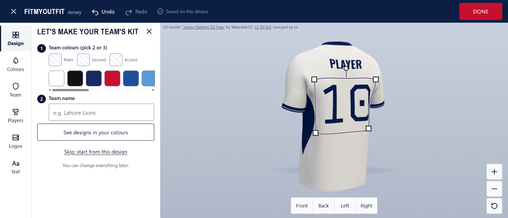

*Today's build in the founder's state (1420 × 612, scale 1.35). The number has stopped growing at 318 mm wide, below the name; the turn handle still sits on "PLAYER"; the start card is still open and no tool is shown.*

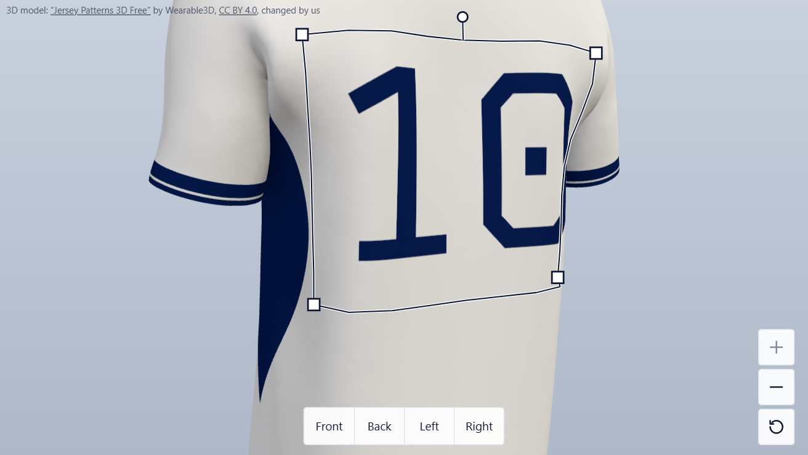

*The same state at maximum zoom: the garment fills the stage, the box's top edge and its turn handle reach the credit line, the box's right edge kinks and the "0" crosses it.*

| # | His point | Status today | Evidence |
| --- | --- | --- | --- |
| 1 | Start card and editing at the same time | **Still there** | With the card open, a click on the back selected `player-number-1` at the first try; the card stayed, no tool panel appeared (`tool-panel` absent), and the resize was applied and saved. Finding **R1**. |
| 2 | Selection outline crooked, not a box | **Still there, milder** | The outline is a 32-point polyline along the cloth (`.fmo-box-line`); the corner handles come from a flat plane. At an angle the bottom edge bends and the bottom-right handle sits about 20 px off the line's end (picture above). **R31**. |
| 3 | Number grown over the name and onto the side panel | **Partly fixed** | The number now stops at its print area: 318 × 250.7 mm, its top edge at 186.7 mm, 22 mm below the name's box (ends at 164.4 mm). It no longer reaches the navy side panel. **Still there:** its turn handle (24 px stem) lands between the "A" and the "Y" of PLAYER at 1420, 1366 and on the T-shirt at 390. **R33**. |
| 4 | Garment cut off at the top; zoom and turn let it leave the stage | **Partly fixed** | At rest the garment is whole at every size I measured (no edge touched). Zooming in still pushes the collar out of the stage and puts the selected item and its turn handle under the credit line (picture above), because the camera can only zoom towards the garment's centre. Reset is always visible. **R24**. |
| 5 | Browser scrollbar under the colour row | **Still there** | `start-colours`: content 805 px in a 299 px row, a classic 10 px scrollbar with arrows. The same under "Parts of the kit" and every lettering colour row, and a 15 px bar in long panels. **R3**. |
| 6 | Two left edges, and differing right edges, in the start card | **Still there** | Left edges at panel +16 (title, step numbers, "See designs") and +48 (labels, colour slots, field), the colour row at +46. Right edges at −17 (field, button), −15 (colour row, cut mid-swatch), −9 (close button). Picture in **R2**. |
| 7 | Warning badge unexplained | **Still there** | Selecting the item now opens its tool, but the warning text is below the fold (y 678 to 915 in a 768 px window). The badge is `aria-hidden` with no title. **R15**. |
| 8 | "Saved on this device" before anything was chosen | **Fixed** | On first open the save state is empty; it appears after the first change. In his screenshot it followed his resize of the number, which is a change. The root cause of his impression is point 1: a change was possible while the card still asked for colours. |

---

## 3. Findings

Measurements are CSS px. "Panel +16" means 16 px in from the panel's left edge; "−17" means 17 px in from its right edge. The wide panel is 360 px wide (x 88 to 448 on the page), so its content box with 16 px padding runs from x 104 to x 432.

### 3.1 Start card

#### R1 · Editing behind the start card · **Must**
- **State, size:** first open, start card open; every size.
- **Picture:** [07-01](img/07-01-founder-state-now.png).
- **Wrong:** A tap or click on an item on the model selects it while the start card stays open. Handles appear, resizing works and is saved, but the panel area still shows the card, so the item's tool and any warning cannot appear.
- **Should be:** As the coordinator decided: the first tap on an item while the card is open closes the card as "Skip" (colours and name picked so far are kept), selects the item and opens its tool. Turning the garment by dragging empty stage keeps the card open.
- **Why:** A coach who goes straight to the shirt should not be stopped, and must never edit with no tool in view (opinion, agreed with the coordinator's note).
- **Check:** Fresh profile, 1366 × 768. Pick Red, then click the number on the back: `start-card` is gone, `tab-players` has `aria-selected="true"`, `data-selected="player-number-1"`, and `design.teamColors.main` is Red. Drag on empty stage with the card open: the card stays.

#### R2 · Two left edges in the start card · **Must**
- **State, size:** start card, every size.
- **Picture:** 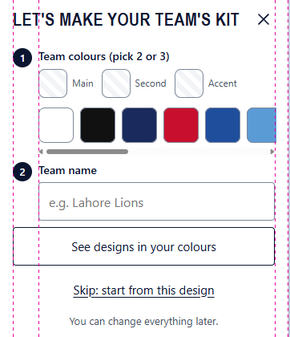 *Magenta lines at panel +16, +48, −17 and the panel edge.* Also [07-04](img/07-04-start-card-390.png) (390).
- **Wrong:** The step numbers sit in a 24 px gutter (`.fmo-start-step { grid-template-columns: 24px 1fr; gap 8 }`), so labels, colour slots, the colour row and the field start at +48 (+46 for the row with its −2 margin), while the title, the numbers and "See designs in your colours" start at +16. The colour row ends at −15 and cuts a swatch in half; the field and button end at −17.
- **Should be:** One left edge at +16 and one right edge at −16 for every block. Put the step number inline in the label row: `1` as a 24 px circle, 8 px gap, then the label, all in one flex row (`align-items: center`). Slots, swatches and field start at +16 under the circle. On wide layouts the swatches wrap (R3), so no swatch is cut. "Skip" and "You can change everything later." stay centred: centred text is the one allowed exception.
- **Why:** The founder's point 6, and the panel grid rule in section 4.
- **Check:** At 1366, 390 and 360, every full-width block in `.fmo-start` has `left − panel.left = 16` and `panel.right − right = 16` (±0.5).
- **Decision D1** (section "Decisions" at the end of this chapter) offers the alternative of indenting everything instead.

#### R3 · Browser scrollbars on rows and panels · **Must**
- **State, size:** desktop (wide) and landscape: start card, Colours, Team, Players, Text (every lettering colour row), every panel longer than the window.
- **Picture:** [07-03](img/07-03-start-card-edges-1920.png), [07-07](img/07-07-colours-panel-1366.png).
- **Wrong:** `.fmo-scroll-row` has `overflow-x: auto; scrollbar-width: thin`. On Windows this draws a 10 px classic scrollbar with arrow buttons under the swatches (start card: 805 px of swatches in 299 px). "Parts of the kit" chips scroll the same way in a 360 px panel that has room for them in two rows. The panel body shows a 15 px classic vertical scrollbar.
- **Should be:**
  - **Wide and short layouts:** rows wrap. `.fmo-editor:is([data-layout="wide"],[data-layout="short"]) .fmo-scroll-row { flex-wrap: wrap; overflow: visible; }`. Start card: six 44 px swatches per row at 8 px gaps (6 × 44 + 5 × 8 = 304 px, inside 328). "All colours" stays as the last chip.
  - **Compact:** keep the sideways scroll (the cut-off last item is the cue, Baymard, see 01-research), hide the bar (`scrollbar-width: none; ::-webkit-scrollbar { display: none }`) and fade the end edge: `mask-image: linear-gradient(to left, transparent 0, #000 24px)` when the row is scrollable and not at its end.
  - **Panel body (all layouts):** `scrollbar-width: thin; scrollbar-color: var(--fmo-border-strong) transparent; scrollbar-gutter: stable;` (see R4).
- **Why:** The founder's point 5. A grey bar with arrows under a colour row reads as a broken web page, not a product (opinion).
- **Check:** At 1366 × 768 and 1920 × 1000, for every tool, no element inside `.fmo-editor` has `scrollWidth > clientWidth` with `overflow-x: auto`; the start card shows all common colours in rows.

#### R4 · Right edges jump when a panel scrolls · **Should**
- **State, size:** wide; switching Team (no scroll) and Players (scroll).
- **Picture:** [07-08 Team](img/07-08-team-panel-1366.png) and [07-09 Players](img/07-09-players-panel-1366.png); the magenta lines are at the same x in both.
- **Wrong:** In Team the content ends at panel −17; in Players at −32, because the 15 px scrollbar takes width. Everything right-aligned (switches, number field, help button alignment) moves 15 px when the coach changes tool.
- **Should be:** The content's right edge is the same in every tool. `.fmo-panel-body { scrollbar-gutter: stable; }` with the thin bar from R3, so the gutter is reserved whether or not the panel scrolls; then reduce `padding-inline-end` by the gutter's measured width so the content ends at −16 (measure the thin bar's width in Chrome on Windows after the change; do not guess it).
- **Why:** Panel grid rule (section 4). Controls that move between tools look loose (opinion).
- **Check:** Content right edge (`.fmo-label` of the first field) is identical, ±0.5 px, in all six tools at 1366 × 768.

#### R5 · Start card on a small phone hides the shirt · **Should**
- **State, size:** start card, 360 × 640.
- **Picture:** 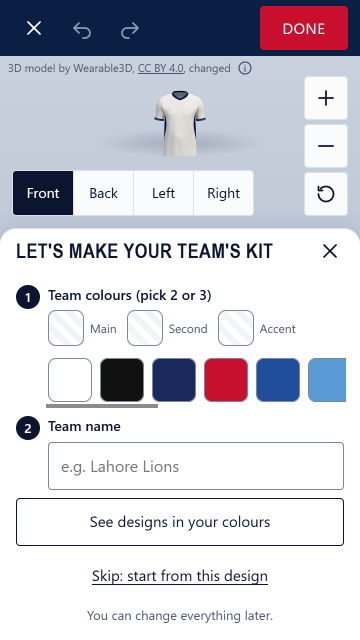
- **Wrong:** The card is 412 px of a 584 px work area (71%). The garment is 52 × 66 px in a strip 120 px tall, beside a stack of +, − and Reset (3 × 44 px + gaps = 140 px) that is taller than the strip. The garment recolours as colours are picked, but the coach can hardly see it.
- **Should be:** While the start card is open on compact, show only Reset (as at the normal panel height), not + and −. Save height in the card: drop the separate Main / Second / Accent slot row and show the pick order on the swatches themselves (a 20 px `ink` badge "1", "2", "3" on the picked swatch's top end corner, with "Main", "Second", "Accent" in its accessible name and a line under the row: "Main: Red · Second: Navy"); this saves 44 px. Move "You can change everything later." into the Skip line ("Skip for now: you can change everything later"), saving 26 px. Target: garment at least 120 px tall at 360 × 640.
- **Why:** MO4 and DY4 of the specification: the garment changes as the coach picks, so it must be visible (evidence: the specification's own checks).
- **Check:** 360 × 640, start card: garment box height ≥ 120 px (magenta method), no stage control overlaps it.

#### R6 · Start card title cut in landscape · **Should**
- **State, size:** 844 × 390.
- **Picture:** 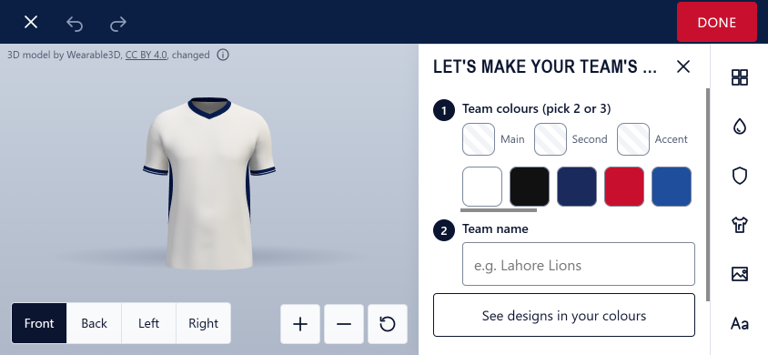
- **Wrong:** "LET'S MAKE YOUR TEAM'S ..." is cut by `text-overflow: ellipsis` in the 320 px panel.
- **Should be:** Panel titles may wrap to two lines (`white-space: normal; display: -webkit-box; -webkit-line-clamp: 2`), never cut. Same rule for every panel title.
- **Check:** At 844 × 390 the title's `scrollWidth ≤ clientWidth` and its full text is visible.

#### R7 · Picked colour slots are 36 px targets · **Polish**
- **State, size:** start card after picking, all sizes.
- **Wrong:** The filled slots (tap to remove) are 36 × 36 px (`.fmo-start .fmo-team-slot .fmo-swatch`), under the 44 px minimum.
- **Should be:** Solved by R5's badges. If the slot row stays, give each slot a 44 × 44 hit area around the 36 px mark.
- **Check:** The audit of targets under 44 px lists no `start-slot-*`.

### 3.2 Panels

#### R8 · One CSS rule overrides every button's type · **Must**
- **State, size:** everywhere.
- **Picture:** the "DONE" button in every top bar picture, e.g. [07-19](img/07-19-done-1366.png); the chips in [07-08](img/07-08-team-panel-1366.png).
- **Wrong:** `styles.ts` line 64, `.fmo-editor button { font: inherit; color: inherit; }`, has specificity (0,1,1). It beats every rule written as one class, (0,1,0). Measured results:

  | Element | Rule intends | Renders |
  | --- | --- | --- |
  | Top bar "Done" (`.fmo-done`) | heading face, 700, 18 px | body face (Segoe UI here), 400, 15/21 |
  | Dock tab labels (`.fmo-tab`) | 12/16, 500 (specification: 14/20) | 15/21, 400 |
  | Chips (`.fmo-chip`) | 14 px | 15/21 |
  | Buttons (`.fmo-btn`) | weight 600 | weight 400 |
  | Text buttons (`.fmo-btn-text`) | weight 500 | weight 400 |
  | Context bar labels (`.fmo-context-btn`) | 11/13 | 15/21 on the phone bar |

  Rules with two classes (`.fmo-editor .fmo-primary`, `.fmo-rail .fmo-tab`) are not affected, which is why "Save and go back" and the rail look right while "Done" does not.
- **Should be:** `:where(.fmo-editor) button { font: inherit; color: inherit; }` (specificity 0,0,1). Then the intended values apply; set the dock labels to the specification's 14/20 (12 px is below the store's smallest text).
- **Why:** MO5 (it must look like our store: condensed headings, one red button with a condensed label). MDN: `:where()` always has specificity 0 (source 8).
- **Check:** `getComputedStyle(done)` gives `font-weight: 700`, `font-size: 18px` and the heading family first; `.fmo-chip` 14 px; `.fmo-btn` 600; dock labels 14/20.

#### R9 · No panel grid: header, Done panel and tablet edges · **Must**
- **State, size:** all panels; Done panel; tablet 820 × 1180.
- **Pictures:** [07-19 Done panel](img/07-19-done-1366.png); 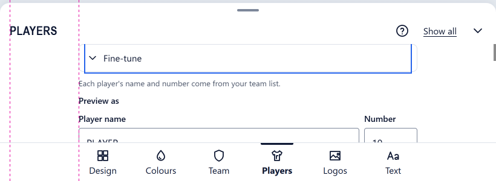 *Tablet: the title at 16 px, the content at 130 px (magenta).*
- **Wrong (measured):**
  - Tool panel header: the "?" and close buttons' boxes end at −9 (header padding `0 8px 0 16px`), so their icons sit at −19, while content ends at −17 or −32.
  - Done panel: padding 20, not 16; its title "YOUR KIT" starts at +36 while its content starts at +20; the close button ends at −28, the content at −20.
  - Tablet (820): `.fmo-panel-inner` limits content to 560 px, centred (x 130 to 690), but the header is not limited: title at x 16, help and close at the far right.
- **Should be:** One panel grid, as a token: `--fmo-panel-pad: 16px` for header, body, help box and the Done panel. Header icon buttons keep their 44 px hit area but sit with `margin-inline-end: -10px`, so the 24 px icon's end edge is on the content edge. The tablet header goes inside the same 560 px centred column as the content.
- **Why:** The founder's "alignment inconsistencies". The grid rule in section 4.
- **Check:** At 360, 390, 820 × 1180, 844 × 390, 1366 and 1920, in every panel and the Done panel: title left = content left; icon glyph right edge = content right (±1).

#### R10 · Text buttons start 17 px inside the edge · **Should**
- **State, size:** Colours ("Edit team colours"), Logos ("Replace", "Remove"), Text ("Remove"); all sizes.
- **Picture:** [07-07](img/07-07-colours-panel-1366.png), [07-17](img/07-17-logo-panel-1366.png).
- **Wrong:** `.fmo-btn-text` keeps the 16 px side padding of `.fmo-btn` (and a 1 px border), so its text starts at +33 while every label above it starts at +16.
- **Should be:** Left-aligned text buttons have `padding-inline: 0` and `min-width: 44px`; their text starts on the content edge. Centred text buttons (Skip, Keep designing) keep their padding.
- **Check:** "Edit team colours" text box left = panel +16.

#### R11 · Section titles look like field labels · **Should**
- **State, size:** Team, Players, Text, Logos; all sizes.
- **Picture:** [07-09](img/07-09-players-panel-1366.png).
- **Wrong:** "Preview as", "On the shirt", "Style", "Where", "Size" are 14/19.6 weight 600, exactly like the field labels "Player name", "Number", "Font". The panel reads as one flat list.
- **Should be:** A section title token, used only for groups: 15/20, weight 700, `ink`, 24 px above (with the 1 px `border` divider 16 px above the title), 8 px below. Field labels stay 14/20 600. See the type table in section 4.
- **Why:** Hierarchy tells a coach where one task ends (opinion).
- **Check:** Type audit: section titles 15/20 700, labels 14/20 600, no other combination for these roles.

#### R12 · Gaps off the scale · **Should**
- **State, size:** all panels.
- **Wrong:** Measured vertical gaps between blocks: 2, 6, 8, 10 and 12 px. 6 comes from `.fmo-label { margin-bottom: 6px }`, 10 from `.fmo-stack` and `.fmo-section` (`* + * { margin-top: 10px }`), 12 from `.fmo-panel-body > * + *`, 8 from the start card's own stack. 6 and 10 are off the store's 4 px scale, and three different values separate the same kind of block.
- **Should be:** Label to its control 8. Control to the next label 16. Between controls of one group (two fields, a chip row and its note) 8. Section to section 24, with the divider. Only 4, 8, 12, 16, 24 in the panels.
- **Check:** The gap audit at 1366 and 390 returns only 4, 8, 12, 16 and 24.

#### R13 · Contextual actions wrap in the desktop panel · **Should**
- **State, size:** wide, a logo or a text item selected.
- **Picture:** 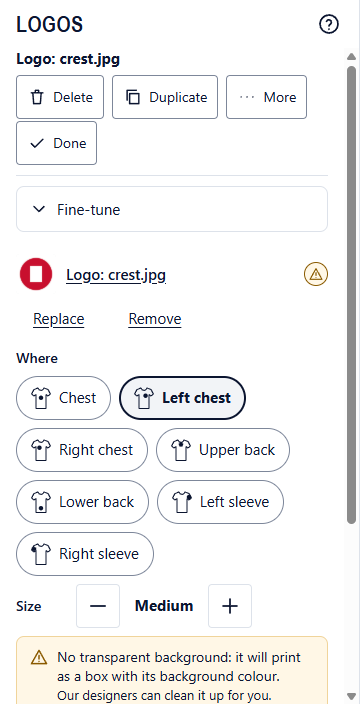
- **Wrong:** Delete, Duplicate, More and Done are bordered 44 px buttons; at 360 px "Done" wraps alone onto a second row.
- **Should be:** One row of four, the same look as the phone's stage bar: icon over label, no border, 44 px tall, each at least 64 px wide (4 × 72 = 288 px, inside 328). Item name above in 15/20 700.
- **Check:** At 1366 with a logo selected, the four actions share one `y`.

#### R14 · Seven logos make a 3,300 px panel · **Should**
- **State, size:** Logos with seven logos, all sizes.
- **Wrong:** Every logo shows its whole card (picture, Replace, Remove, seven "Where" chips, size, warnings). With seven logos the panel body is 3,327 px tall at 1366 and 3,182 px at 390. The "Add a logo" box is at the end.
- **Should be:** Only the selected logo's card is open; the others are 56 px rows (40 px picture, name, place, warning badge, chevron) that open on tap. "Add a logo" stays first, under the title.
- **Check:** Seven logos, none selected: Logos body height ≤ 700 px; selecting a row opens only that card.

#### R15 · A warning is never explained where the coach looks · **Must**
- **State, size:** an item with a warning (white letters on a white back; a JPEG logo), selected; 1366 × 768 and 390 × 844.
- **Picture:** 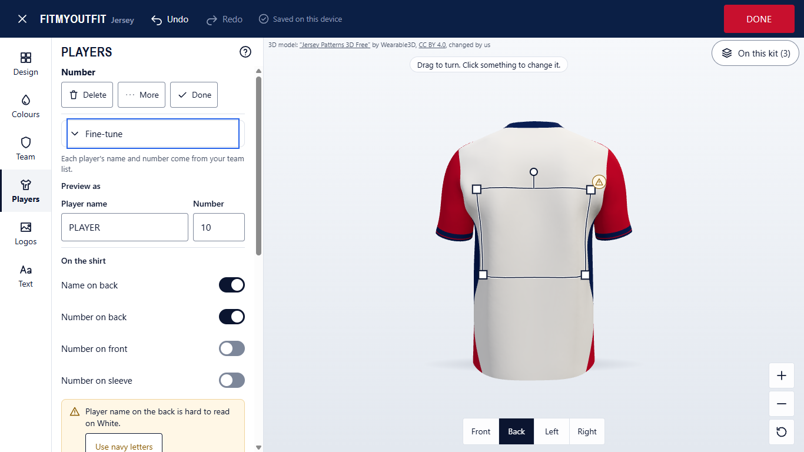 *The badge is beside the box at the top; the text "Player name on the back is hard to read on White" starts at y 678, the fix button is off-screen.*
- **Wrong:** Selecting the item opens its tool, but the warning sits after the style controls, below the fold on desktop and outside the 232 px normal height on phones. After a logo upload with two warnings, the phone shows neither. The badge on the model is `aria-hidden="true"` and has no tooltip.
- **Should be:** When the selected item has a warning, the warning and its one-tap fix sit at the top of the panel, directly under the item's name and actions (above Fine-tune), in the warning alert style. On the model, while the item is selected, the badge is not drawn (the explanation is in view); for unselected items the badge stays, with `role="img"`, an accessible name ("Needs a look: hard to read on White") and a `title`. A click on an unselected badge selects the item.
- **Why:** The founder's point 7.
- **Check:** 1366 × 768 and 390 × 844: select an item with a warning; the warning's text box is fully inside the viewport and inside the panel's visible area without scrolling.

#### R16 · Focus jumps to Fine-tune and its ring is clipped · **Should**
- **State, size:** any item selected from the model or the list; all sizes.
- **Picture:** [07-11](img/07-11-selected-390.png) (ring cut at the top and sides), [07-25](img/07-25-warning-badge-1366.png), [07-23](img/07-23-on-this-kit-1366.png) (the same square ring on the first row of "On this kit", drawn over the row's divider), [07-18](img/07-18-refused-alert-1366.png) (a refused SVG: the focused error alert gets a 4 px-radius ring 2 px outside its 8 px-radius box, so it looks double-bordered).
- **Wrong:** On selection the focus moves to the "Fine-tune" toggle and shows a 2 px focus ring: a sharp rectangle inside a card with 8 px corners. On the phone the panel body's `overflow` cuts the ring's top and sides.
- **Should be:** A pointer selection leaves the focus where it was. A selection from "On this kit" moves focus to the panel's title (`tabindex="-1"`, no visible ring). Focus rings inside scrolling panels use `outline-offset: -2px` so they are never clipped, and follow the control's own radius.
- **Check:** Click an item on the model at 1366: `document.activeElement` is not `fine-tune-toggle`. Tab to Fine-tune at 390: the whole ring is visible.

#### R17 · No hover state on most controls · **Should**
- **State, size:** wide, mouse.
- **Wrong:** The stylesheet has `:hover` rules only for top bar buttons, Done, context buttons, menu items, `.fmo-btn`, text buttons and the primary button. Chips, segmented controls, swatches, design cards, tool tabs, view buttons, zoom, Reset and "On this kit" have none.
- **Should be:** Pointer hover on every interactive element: chips, segmented buttons and tabs get `background: var(--fmo-surface-alt)` (tabs: label to `ink`); swatches and cards get a 1 px `border-strong` outer ring; stage controls get a solid `surface` fill. Hover never looks like selected.
- **Check:** With the mouse over each control type, its computed background or box-shadow differs from rest and from selected.

#### R18 · Colour rows repeat the team colours · **Polish**
- **State, size:** Team, Players, Text: the colour row.
- **Picture:** [07-08](img/07-08-team-panel-1366.png): red, navy, then white, black, navy, red.
- **Wrong:** The team colours are shown, then the common colours include them again. No divider or group words between them (the specification asked for "Team, a divider, Recent").
- **Should be:** Team colours, a 1 px divider, then the common colours without the team colours.
- **Check:** No palette id appears twice in one row.

#### R19 · Font names carry catalogue notes · **Polish**
- **State, size:** Team, Players, Text: the font button.
- **Picture:** [07-09](img/07-09-players-panel-1366.png).
- **Wrong:** "Oswald Bold (names)", "Graduate (varsity numbers)": notes meant for us, and the long one wraps under the label, right-aligned.
- **Should be:** The font's display name only ("Oswald", "Graduate"), set in the font, on one line with an ellipsis if needed; the font list (4.5.1) shows the coach's own text in each font.
- **Check:** No "(" in any font button.

#### R20 · The colour-code result appears below the fold · **Should**
- **State, size:** Colours, "Match a colour code", 1366 × 768.
- **Picture:** 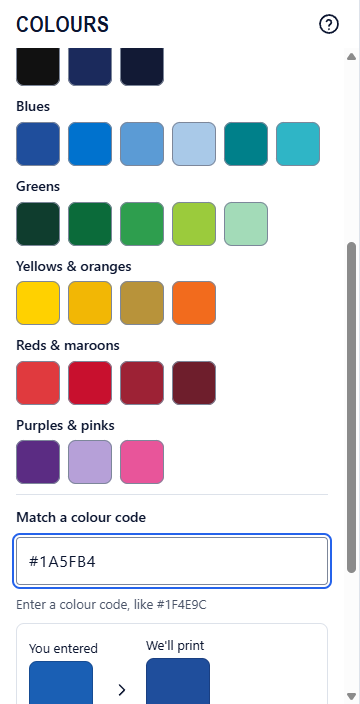
- **Wrong:** After a valid code the "You entered / We'll print" block starts at y 690 and its "Use" button is off-screen. Nothing on screen says a result exists.
- **Should be:** When the result appears, scroll it into view (`scrollIntoView({ block: "nearest" })`, instant with reduced motion).
- **Check:** Type `1A5FB4`: the "Use …" button is inside the viewport.

#### R21 · The swap control is a bare icon · **Polish**
- **State, size:** Colours, team colours row.
- **Picture:** [07-07](img/07-07-colours-panel-1366.png).
- **Wrong:** "⇄" floats after the team swatches with no boundary and no word.
- **Should be:** A chip: icon and "Swap" (accessible name "Swap main and second").
- **Check:** Visible label "Swap".

### 3.3 Stage

#### R22 · The garment is too small on phones · **Must**
- **State, size:** compact, every tool and every selection.
- **Pictures:** 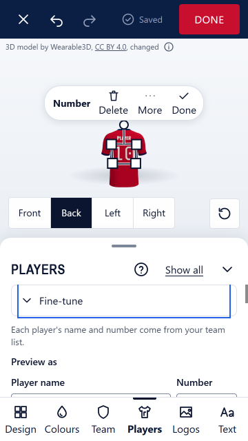 *360 × 640: the number is about 40 px wide, the garment 66 × 85 px.* Also [07-26](img/07-26-design-expanded-390.png) (390, Design expanded: 88 × 111 px garment).
- **Measured (garment height ÷ free stage height):**

  | Size, state | Garment | Fill |
  | --- | --- | --- |
  | 390 × 844, Colours normal | 210 × 270 | 0.55 |
  | 390 × 844, team name selected | 183 × 235 | 0.48 |
  | 390 × 844, any tool expanded | 88 × 111 | 0.51 |
  | 360 × 640, number selected | 66 × 85 | 0.29 |
  | 844 × 390, number selected | 98 × 127 | 0.37 |
  | 820 × 1180, number selected | 381 × 499 | 0.60 |

- **Should be:** The framing rule in section 4: at rest the garment's height is 72 to 80% of the free stage; with an item selected on compact, the camera zooms toward the item until its box is at least 120 px on its longer side (or the zoom limit), keeping the item inside the free stage.
- **Why:** MO4 (opinion when written; the measurements show why). A 40 px number with four 14 px handles cannot be resized by a thumb.
- **Check:** Magenta method: fill ≥ 0.72 at rest at 360 and 390; selected item's box ≥ 120 px at 360 × 640.

#### R23 · The garment is small on desktops too · **Should**
- **State, size:** wide.
- **Measured:** 1366 × 768: 326 × 423 in a 704 px stage (0.60). 1920 × 1000: about 0.67. A third of the stage is empty grey above and below.
- **Should be:** 75 to 80% of the free stage height (stage minus the top row and the view-control row, section 4).
- **Why:** Opinion: the kit is the product; empty grey makes it look like a test page.
- **Check:** Magenta method at 1366 × 768: fill ≥ 0.75, no edge touched.

#### R24 · Zooming pushes the garment and the selection out · **Must**
- **State, size:** wide and compact, an item selected, zoomed in.
- **Picture:** [07-02](img/07-02-founder-max-zoom.png).
- **Wrong:** The camera always aims at the garment's centre, so zooming in to work on a number on the upper back pushes the number up and out; at the founder's size the box's top edge and its turn handle reach the credit line at the stage's top.
- **Should be:** With an item selected, zoom aims at the item's centre (the camera target moves along the garment's vertical axis toward the item, clamped so the garment's centre stays in view). Without a selection, the wheel zooms toward the point under the pointer, with the same clamp. The selection overlay is clipped to the free stage (below the top row, above the view row). Reset always returns to the rest framing.
- **Why:** The founder's point 4.
- **Check:** 1420 × 612, number selected, zoom to the limit: the number's box stays fully inside the free stage; no handle overlaps `model-credit`.

#### R25 · Stage buttons barely show against the stage · **Should**
- **State, size:** every layout: view buttons, zoom, Reset.
- **Wrong:** `.fmo-round` and `.fmo-sides` use a 92% white fill and a 1 px `--fmo-border` line (#DDE2EA in the package's fallbacks). Against the stage top (#F6F8FB) the fill is 1.06:1 and the line 1.06:1; against the stage bottom 1.23:1. The icons and words pass (they are what identifies them, WCAG 1.4.11 does not require a boundary then), but the buttons read as faint tiles. "On this kit", next to them, uses `border-strong` and looks like a different family.
- **Should be:** One look for every control floating on the stage: fill `surface` at 96%, 1 px line `rgb(11 21 48 / 0.24)`, shadow `0 1px 3px rgb(11 21 48 / 0.12)`. Keep each component's shape (segmented and square buttons 4 px, chips and the bar as pills).
- **Why:** WCAG 1.4.11 (source 8) for the rule; opinion for the look.
- **Check:** Zoom button border colour computes to the new value; side-by-side screenshot reads as one family.

#### R26 · The hint stays and stacks with the bar · **Should**
- **State, size:** 390 × 844 after selecting from a list; 1366 after many actions in panels.
- **Picture:** [07-11](img/07-11-selected-390.png): credit (56 to 80), hint (88 to 115) and context bar (124 to 175) stacked above the garment.
- **Wrong:** "Drag to turn. Tap something to change it." goes only when the stage is touched. A coach who works in the panels keeps it for the whole session, and it stacks with the contextual bar.
- **Should be:** The hint goes on the first touch of the stage, the first selection, the first tool change, or after 8 s, whichever comes first, and never shows together with the contextual bar, the status line or "Turn to edit" (one row, section 4).
- **Check:** Select from "On this kit" on a fresh profile: `stage-hint` is gone.

#### R27 · Landscape: the contextual bar runs under the panel · **Must**
- **State, size:** 844 × 390, an item selected.
- **Picture:** 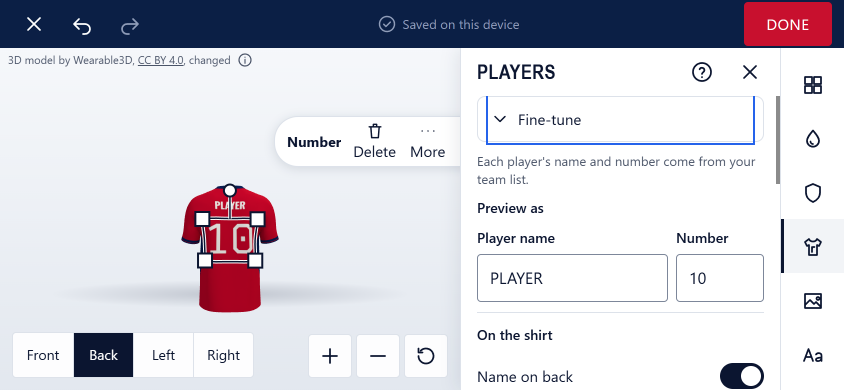
- **Wrong:** `.fmo-context-place` spans the whole work area (`inset-inline: 8px`) and centres the bar in it. The side panel covers x 460 to 780, so the bar's right part, "Done", is under the panel.
- **Should be:** The bar is centred in the free stage: `inset-inline-end` = the panel's width + 8 in the short layout (the same `viewInsets.right` the camera uses). If it does not fit, the item name truncates first.
- **Check:** 844 × 390, number selected: `context-done` is visible and its right edge ≤ panel left − 8.

#### R28 · Flat view: the banner runs under "On this kit" · **Should**
- **State, size:** flat view, 390 and 1366.
- **Picture:** 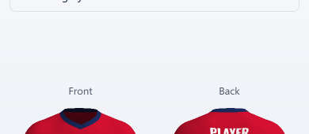
- **Wrong:** The banner and the kit button overlap by 40 × 40 px (390) and 145 × 40 px (1366); "You can still design your kit here." is cut.
- **Should be:** The banner's end edge stops 8 px before the kit button (or the banner sits under the top row). Section 4's stage rule.
- **Check:** The overlap audit lists no `kit/banner`.

#### R29 · The Done panel covers the view controls and darkens the kit · **Should**
- **State, size:** wide, Done panel open.
- **Picture:** 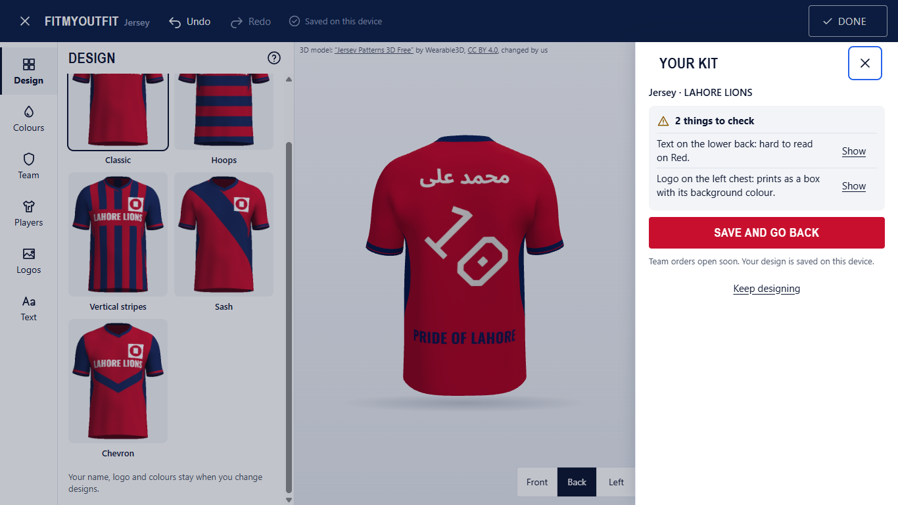
- **Wrong:** The garment is re-framed to the left of the 400 px panel, but the view buttons are not: "Right" and the zoom column are under the panel. The backdrop (`rgb(11 21 48 / 0.25)`) dims the kit the panel asks the coach to check.
- **Should be:** View controls follow `viewInsets.right` (or hide while the Done panel is open). The backdrop covers the tools only, not the stage (the dialog stays modal), or drops to 0.08.
- **Check:** With Done open at 1366, no view control is under the panel; stage pixels at the garment are within 5% of their colour without the panel.

#### R30 · Credit link leaves gaps ("Verma,    MIT   , changed") · **Polish**
- **State, size:** T-shirt, every size.
- **Picture:** 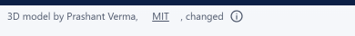
- **Wrong:** The licence link has `min-width: 44px` with centred content, so a short word ("MIT") sits in a 44 px box with spaces on both sides.
- **Should be:** Keep the 44 px target with an invisible extension (`position: relative` and `::after { content: ""; position: absolute; inset: -10px -8px; }`), not with width.
- **Check:** The gap between "Verma," and "MIT" equals one space.

### 3.4 Selection and handles

#### R31 · The outline is not a box · **Must**
- **State, size:** any selected item, most visible at an angle and when zoomed; all sizes.
- **Pictures:** [07-01](img/07-01-founder-state-now.png), [07-02](img/07-02-founder-max-zoom.png).
- **Wrong:** The outline polygon follows the cloth (32 points), while the corner handles are placed on a flat plane where a corner is off the cloth. Edges bend, corners kink, handles sit off the line, and the glyphs of a large number cross the outline.
- **Should be:** As the coordinator wrote: four straight lines between the four projected corner points, handles on those corners, the turn handle on the middle of the top edge on its stem. The two-tone line stays (1.5 px `ink` over 3.5 px white).
- **Why:** The founder's point 2. A selection that kinks reads as broken (his word).
- **Check:** `.fmo-box-line` has exactly 4 points; each corner handle's centre equals one of them.

#### R32 · The box hugs the item; handles cover it · **Must**
- **State, size:** every selected item; worst on phones and for small logos.
- **Pictures:** 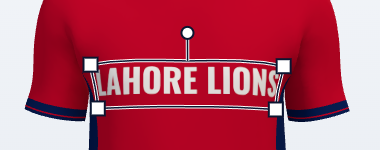 *The "L" and the "S" are under the handles.* 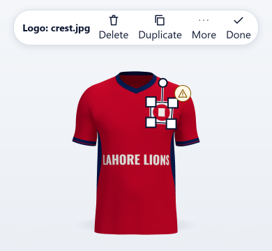 *The logo is hidden by its handles and badge.*
- **Wrong:** The box is the item's own box. Text fills it edge to edge, so the corner handles (14 px squares) sit on the first and last letters. A left-chest logo at 390 is about 40 px wide; its four handles and the badge cover it.
- **Should be:** Draw the box outset by 8 px on every side in screen space (each corner moved 8 px away from the centre along its diagonal direction, normalised), with handles on the outset corners. If the projected item is smaller than 44 px on a side, draw a 44 px box around its centre. The badge is not drawn while the item is selected (R15).
- **Why:** The coach must see what they are editing (opinion).
- **Check:** At 390 and 1366, team name and a left-chest logo selected: no handle square intersects the item's projected box; the drawn box is ≥ 44 px on each side.

#### R33 · The turn handle lands on the next item · **Must**
- **State, size:** the number selected (it sits under the name); both models, all sizes.
- **Pictures:** [07-01](img/07-01-founder-state-now.png), [07-13](img/07-13-number-selected-360.png), and the T-shirt at 390.
- **Wrong:** The turn handle is always 24 px above the top edge's middle. Above the number is the player's name, so the handle sits on "PLAYER".
- **Should be:** Default above. If the turn handle's 44 px hit circle intersects another item's projected box (or the top row), place it below the bottom edge instead; if that is blocked too, at the end side's middle. The stem follows.
- **Why:** The founder's point 3: a handle on another item invites the wrong drag.
- **Check:** Number selected, back view, 1366 and 390: the handle's hit circle does not intersect the name's box.

#### R34 · Small items get a crowd of marks · **Should**
- **State, size:** a left-chest logo, 390.
- **Picture:** [07-12](img/07-12-logo-selected-390.png).
- **Wrong:** Four handles, the turn handle and its stem, and a 24 px warning badge sit within 70 px; the badge overlaps the top-end handle's hit area by 20 × 24 px.
- **Should be:** R32's minimum box and R15's "no badge while selected" solve it. Hit areas of handles may overlap the box, never each other or another control.
- **Check:** The overlap audit lists no `badge/handles`.

#### R35 · Guides run through the text being moved · **Should**
- **State, size:** dragging the team name, 390.
- **Picture:** 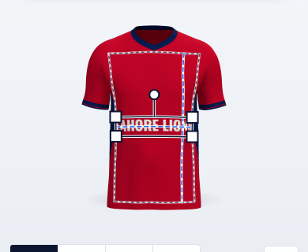
- **Wrong:** The blue dashed centre guide runs through the middle of the letters; a second blue guide runs down the right side. The coach cannot read the name while placing it.
- **Should be:** Guides are not drawn inside the moved item's box (break the polyline where it enters the box, 4 px gap). Show only the guide that is snapping now, not every candidate.
- **Check:** While dragging, no `snap-guide` segment lies inside the item's drawn box.

#### R36 · The flat view selection looks different · **Polish**
- **State, size:** flat view.
- **Wrong:** The selected item has a thin blue double rectangle; the 3D view uses the `ink` and white two-tone line.
- **Should be:** The same two-tone line (and, later, handles).
- **Check:** Same stroke colours in both views.

### 3.5 Phone layout and the Done panel

#### R37 · The Done panel's height ignores its content · **Should**
- **State, size:** compact, Done panel.
- **Picture:** [07-20](img/07-20-done-390.png): about 130 px of empty white under "Keep designing", while the kit above is 220 px tall.
- **Should be:** Height = content height, at most `min(60dvh, 100dvh − 56 − 160)`; the stage gets the rest.
- **Check:** Bottom padding under the last control ≤ 24 px + safe area.

#### R38 · The phone Done panel is a sheet on a sheet · **Must**
- **State, size:** compact, a tool panel expanded, then Done.
- **Picture:** 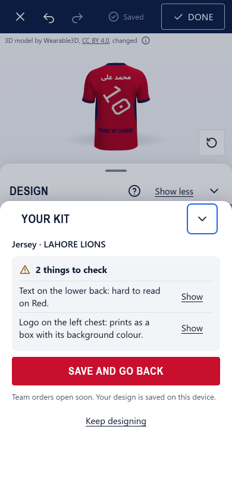 *"DESIGN · Show less" shows above the Done sheet.*
- **Wrong:** The Done panel opens over the expanded tool panel, which stays visible behind it.
- **Should be:** Opening Done closes the tool panel (detent closed), and closing Done restores the tool and its detent. One sheet at a time.
- **Why:** Evidence: NN/g calls stacking "one of the biggest issues with bottom sheets" and advises against sheets on top of sheets (source 8). The specification's rule "one panel at a time" (3.3).
- **Check:** 390, Design expanded, Done: `tool-panel` is not visible; close Done: Design is back, expanded.

#### R39 · Normal-height panels cut a line in half · **Polish**
- **State, size:** compact, Colours at normal height.
- **Picture:** 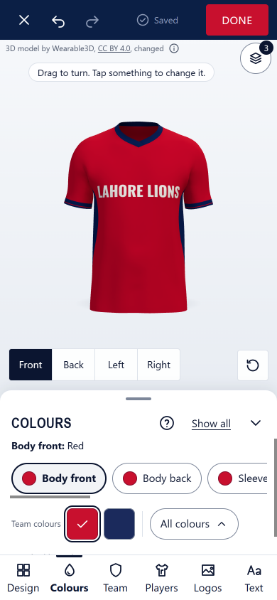
- **Wrong:** The "Recently used" row is cut mid-line at the dock's edge; the panel's own content is 192 px in a 163 px body.
- **Should be:** Normal height snaps to whole rows: end the body after the last complete row, with a 16 px fade at its bottom edge when it scrolls.
- **Check:** At normal height the last visible text line is complete.

### 3.6 Dialogs and wording

#### R40 · "Continue your last design?" focuses "Start again" · **Must**
- **State, size:** reopening the editor with a saved design; all sizes.
- **Picture:** 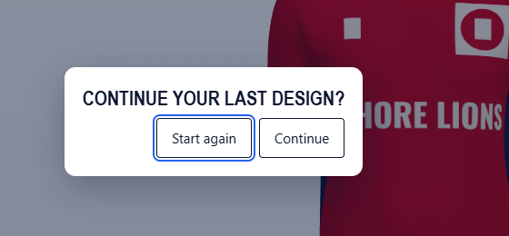
- **Wrong:** "Start again" is first and has the focus, so Enter or Space throws the saved design away. Both buttons look the same; nothing says what either does.
- **Should be:** Focus on "Continue", placed at the end (right), filled `ink` (not red: the one red button stays "Done"); "Start again" before it as a secondary button. One sentence under the title: "We kept the kit you were working on, on this device." (draft wording, founders to confirm).
- **Check:** On open, `document.activeElement` is `resume-continue`.

### Decisions for the coordinator

- **D1. Start card layout (R2).** (a) One left edge: the step number moves inline into the label row; everything starts at +16. (b) Keep the numbered gutter and indent every block to +48, including "See designs". **Recommendation: (a)**, because (b) wastes 32 px of a 328 px column on a phone and still leaves the title on another edge.
- **D2. Where a selected item's warning shows (R15).** (a) At the top of the panel under the item's name, the badge hidden while selected. (b) A small popover from the badge on the stage. **Recommendation: (a)**: the fix button is then next to the item's other controls, and nothing new covers the garment.
- **D3. Desktop contextual actions (R13).** (a) Keep them in the panel as one row of icon-over-label buttons. (b) Move them to the stage like the phone. **Recommendation: (a)**, as the specification says: on a desktop the panel is always open and the stage stays clear.
- **D4. Fonts in the demo.** The demo loads no interface fonts, so the founder sees Arial Narrow for headings and Segoe UI for everything else (measured with `CSS.getPlatformFontsForNode`). (a) Load Barlow Condensed and Inter in the demo page (self-hosted files, licences checked by the developer from each font's own repository). (b) Accept the fallback. **Recommendation: (a)**: the founder judges the look from this demo, and Arial Narrow at 700 is visibly heavier and wider than Barlow Condensed. It is a demo change, not a package change (decision 009: the host provides the fonts).

---

## 4. Rules to add to the specification

Each rule can be tested from the page. Together they replace the judgment calls that produced most findings above.

**4.1 Panel grid.**
- `--fmo-panel-pad` = 16 px, on the tool panels, the start card, the Done panel and the help box.
- Every full-width block (field, button, alert, card list, section) starts at the content's start edge and ends at its end edge. Rows of chips, swatches and segmented controls start at the start edge and may end short.
- Icon buttons in a header keep a 44 px hit area; their icon's edge is on the content edge.
- Centred text (Skip, Keep designing, small notes under a main button) is the only exception.
- On tablets the header and the content share the same centred 560 px column.
- The content's end edge does not move when a panel starts scrolling.
- *Test:* at 360, 390, 820 × 1180, 844 × 390, 1366 and 1920, for every panel, the set of left offsets of full-width blocks is {16} and the set of right offsets is {16}.

**4.2 Spacing scale in use.** 4, 8, 12, 16, 24 only. Label → control 8. Controls of one group 8. Group → next label 16. Section → section 24, with a 1 px `border` divider placed 16 px above the next section's title. *Test:* the gap audit returns no other value.

**4.3 Type tokens for the editor** (sizes in px, size/line height, Latin; Arabic script gets 1.2 × the line height):

| Token | Value | Use |
| --- | --- | --- |
| `panel-title` | heading 700 uppercase, 20/26 compact, 22/28 wide; may wrap to 2 lines | Panel and dialog titles |
| `section-title` | body 700, 15/20 | Group titles in a panel |
| `label` | body 600, 14/20 | Field and control labels |
| `body` | body 400, 15/21 | Running text, chips, buttons' words |
| `button` | body 600, 15/20 | Secondary and text buttons |
| `primary` | heading 700 uppercase, 18/18 | Done, the Done panel's main action |
| `tab` | body 500, 14/20 (650 when selected) | Dock and rail labels |
| `small` | body 400, 13/18 | Notes, save state, hint |
| `credit` | body 400, 11/16 | The model credit only |

*Test:* the type audit returns only these combinations.

**4.4 Stylesheet scoping.** The package's element resets use `:where()` so they never outrank a component class. *Test:* every button's computed font matches its component rule (R8's table).

**4.5 Selection box drawing rule.**
- Four straight lines between the four projected corners, outset 8 px in screen space; never a polyline along the cloth.
- At least 44 × 44 px on screen; grown around the item's centre if smaller.
- Corner handles on the outset corners; the turn handle on a 24 px stem from the middle of the top edge, moved below (or to the end side) when its hit area would touch another item or a stage control.
- No badge on the selected item; its warning is in the panel.
- The overlay is clipped to the free stage.
- Guides are drawn only where snapping happens now, and not inside the moved item's box.
- *Test:* 4 points; handles never intersect the item's projected box, another item's box, or a stage control.

**4.6 Stage framing rule.**
- **Free stage** = the stage minus the top row (credit line 24 px, and the 52 px row of the hint or bar when shown) and minus the bottom row (view controls 44 px + 12 px), and minus any panel (`viewInsets`).
- **At rest:** the garment's height is 75 to 80% of the free stage on wide layouts and 72 to 80% on compact, centred in it, never under a row.
- **Item selected, compact:** zoom toward the item until its box is at least 120 px on its longer side (wide: 160 px), or the zoom limit; the item and its handles stay inside the free stage.
- **Zoom** aims at the selected item, or at the pointer without a selection, clamped so the garment's centre stays in view.
- *Test:* magenta measurement of the garment and of the item's box.

**4.7 What may sit on the stage, and where.**

| Place | What | Rule |
| --- | --- | --- |
| Top start | The credit line | One line, never over the garment |
| Top end | "On this kit" | Icon-only below 480 px |
| Top row, centred in the free stage | **One** of: contextual bar, status line, "Turn to edit", hint (in that priority) | Never two at once |
| Under the top row, full width minus the kit button | Flat-view or error banner | Ends 8 px before the kit button |
| Bottom start (compact) / bottom centre of the free stage (wide) | Front, Back, Left, Right | Follows `viewInsets` |
| Bottom end | Zoom pair and Reset (Reset only at normal height and with the start card) | Follows `viewInsets` |
| On the garment | Only the selection overlay, and badges on unselected items | — |

All floating controls share one look: `surface` at 96%, 1 px `rgb(11 21 48 / 0.24)`, shadow `0 1px 3px rgb(11 21 48 / 0.12)`. *Test:* the pairwise overlap audit of stage controls is empty in every state.

**4.8 Native controls.** No classic scrollbar under a row on wide layouts (rows wrap); the panel body has a thin bar with a stable gutter; on compact, rows scroll without a bar and with an end fade. *Test:* no element with horizontal overflow on wide layouts.

**4.9 States.** Every interactive component has rest, hover (pointer only), focus-visible (2 px `focus` ring, offset 2, or −2 inside a scrolling panel, following the control's radius), pressed or selected, and inactive. *Test:* a state sheet screenshot of each component.

**4.10 One sheet at a time on compact, including the Done panel.** *Test:* never two visible sheets.

**4.11 Default focus in dialogs** is on the safe action ("Continue", "Stay"). *Test:* `activeElement` on open.

---

## 5. Where my specification was wrong or silent

To be applied to [06-editor.md](06-editor.md) afterwards; not edited in this task.

1. **3.1 and 3.5, the smallest desktop.** I designed down to 1280 × 720. The founder's real window is about 1420 × 612 CSS px (scale 1.35). Add 1366 × 600 as the smallest wide size to check, and make the framing rule (4.6) hold there.
2. **6.1, view controls.** I specified "`surface` at 92% opacity with a 1 px `border` line". That line is 1.06:1 against the stage: wrong. Replace with 4.7's control look.
3. **7.2, the start card sketch.** My drawing put the step numbers in a gutter and the button at full width: it produced the two edges. Replace with the inline step number (R2, D1) and R5's swatch badges.
4. **5.2, handles.** I specified the two-tone line and handle sizes but not the outset, the minimum box, the turn handle's placement, or that the box is four straight lines. Add 4.5.
5. **12, tokens.** I gave no section-title token, no panel grid and no spacing steps beyond "4 px base". Add 4.1 to 4.3. Also state that the package's fallback values must equal 03-direction's values: today they differ (`border` #DDE2EA instead of #C9D1DE, `border-strong` #7D879A instead of #6B7689, `inverse` #0B1F45 instead of #0B1530, `on-inverse-muted` #8F9CB8 instead of #B8C2D6, `ink-muted` #4A5468 instead of #4A5568, `surface-alt` #F2F4F7 instead of #F3F5F9, `success` #17703A instead of #0F7A3D). With these fallbacks `border-strong` on white is 3.6:1 instead of 4.6:1.
6. **3.3, tablet.** I limited the content to 560 px but did not say the header follows it.
7. **9.2, the Done panel on compact.** I said "the panel area at expanded height" without saying the tool panel closes. Add 4.10; and the panel's height follows its content.
8. **7.4, the hint.** "Dismissed by any touch on the stage" is not enough for a coach who works in the panels. Add R26's rule.
9. **4.6 and 4.5, warnings.** I placed the warnings in the tool's style section. They must lead the panel while their item is selected (R15, D2).
10. **9.3, the resume prompt.** Silent on the default focus and the order of the buttons. Add 4.11.
11. **MO4.** "The garment keeps at least 45% of the screen height" was ambiguous (the build reads it as the stage). Restate as a measurement of the garment's own box in the free stage (4.6).
12. **3.6, top bar.** I did not test the type of "Done" in a screenshot check; add the type audit (4.3) to the review checklist in 15.3.

---

## 6. What I could not judge from this machine

- **Real phones.** All phone results come from Chrome's device emulation on a desktop GPU. I could not judge how big the handles feel under a thumb, whether a 14 px handle is grabbed reliably, how the overlay scrollbars behave (on a real Android phone they fade; in emulation the thin grey bar under the swatch and chip rows stayed visible, so I did not count it as a defect), the safe areas, or the keyboard opening.
- **Safari and iOS.** Not available here: `dvh`, the native `<dialog>`, the file picker, the scrollbar styling and the font fallbacks may differ.
- **The real fonts.** Barlow Condensed and Inter are not loaded by the demo, so every type judgment is on Arial Narrow and Segoe UI. The sizes and weights are measured from the stylesheet and hold for the real fonts; the look does not.
- **Speed.** I did not measure how fast the model answers; QA's twelfth report did (template tap p75 38 ms on this machine, 165 ms at 4 × CPU slowdown). Feel on a mid-range phone is untested.
- **Hover.** Hover states were judged from the stylesheet (R17), not with a person's mouse.
- **The founder's scale.** 1.35 is inferred from his screenshot's pixel sizes; his exact Windows setting is not known.
- **1920 × 1000** was used for the founder's state and the start card. The other states were walked at 1366 × 768; the wide layout is the same (88 px rail, 360 px panel) with a larger stage.

**What the founder should look at himself:** on his own phone, select the team name and a logo and try to resize them with a thumb after R31 to R34 are fixed; and on his desktop, the start card and the Colours panel after R2, R3 and R8.

---

## 7. Against Spized and the three words

**Evidence.** Spized's help centre recommends "using the 3D configurator on a laptop or PC rather than a smartphone" (opened 17 Nov 2026, source 8). On 12 Nov its configurator page on a phone said "It's more fun on the desktop!" (06-editor.md 1.1, not re-opened today). I have not seen Spized's configurator itself in a browser (06-editor.md 1, and the brief's rule on other sites), so every comparison below of how it looks is the founder's eye, not mine.

**Where the build already beats it (evidence from this review, opinion on the comparison):**
- Every tool opens and works at 360 × 640 (EZ1); nothing sends the coach to a computer.
- Templates are shown on the real garment in the team's colours and name (DY2; [07-26](img/07-26-design-expanded-390.png)).
- Opening Players turns the camera to the back; Team and Logos turn it to the front (DY3).
- No Apply buttons; the colour-code match shows both colours and prints only palette colours.
- Urdu and Arabic names render correctly on the model and in the lists.

**Where it does not yet (opinion):**
- **Easier:** the start card can be bypassed into a state with no tool (R1); warnings are out of sight (R15); "Start again" is the default (R40).
- **More dynamic:** the selection fights the shirt (R31 to R33), and the garment is small enough on phones that "live" changes are hard to see (R22).
- **More modern:** browser scrollbars, mixed edges and the wrong button face (R3, R2, R9, R8) read as a prototype next to a polished commercial configurator.

**The five changes that would move it furthest (opinion):**
1. The selection box: straight, outset, handles off the item and off its neighbours (R31 to R34).
2. The framing rule: a bigger garment at rest, zoom toward the selected item on phones (R22 to R24).
3. The first minute: the first tap on the shirt closes the start card into the right tool, and the card has one edge and fits a small phone (R1, R2, R5).
4. The desktop finish: no browser scrollbars, the button font fix, one panel grid, real fonts in the demo (R3, R8, R9, D4).
5. Warnings and sheets: the selected item's warning at the top of its panel, one sheet at a time on phones (R15, R38).

---

## 8. Sources

Opened on 17 Nov 2026 unless marked.

- Spized help centre, "The 3D configurator isn't working, what can I do?": https://spized.zendesk.com/hc/en-gb/articles/37608008379421-The-3D-configurator-isn-t-working-what-can-I-do
- W3C, Understanding WCAG 2.2, 1.4.11 Non-text Contrast: https://www.w3.org/WAI/WCAG22/Understanding/non-text-contrast.html
- MDN, `:where()` (specificity 0): https://developer.mozilla.org/en-US/docs/Web/CSS/:where
- MDN, `scrollbar-gutter`: https://developer.mozilla.org/en-US/docs/Web/CSS/scrollbar-gutter
- Nielsen Norman Group, "Bottom Sheets: Definition and UX Guidelines": https://www.nngroup.com/articles/bottom-sheet/
- From earlier documents, not re-opened today: Spized's configurator and pages as listed in 06-editor.md section 17 and [04-reference-spized.md](04-reference-spized.md); Baymard's cue for a cut-off last item, as cited in [01-research.md](01-research.md) section 5.
- QA's twelfth report (speed figures quoted in section 6): the coordinator's scratch notes `qa12/notes.md`, 12 to 13 Nov 2026.
- This review's measurements: the running demo at http://localhost:5183 (`master`, 17 Nov 2026); the founder's screenshot and the coordinator's notes of 17 Nov 2026.
