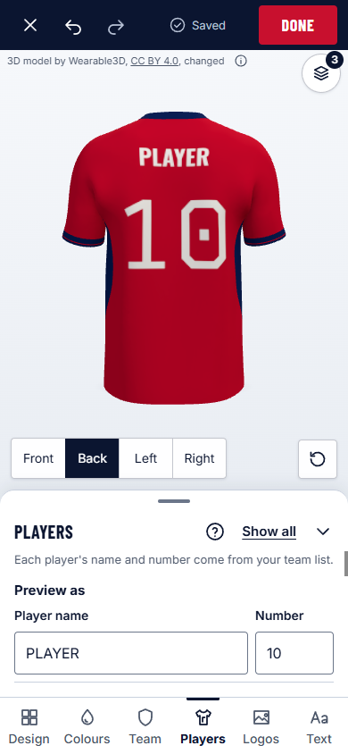
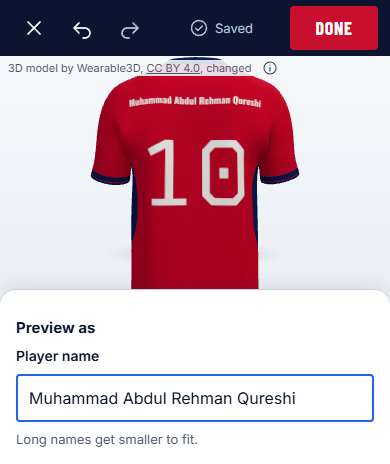
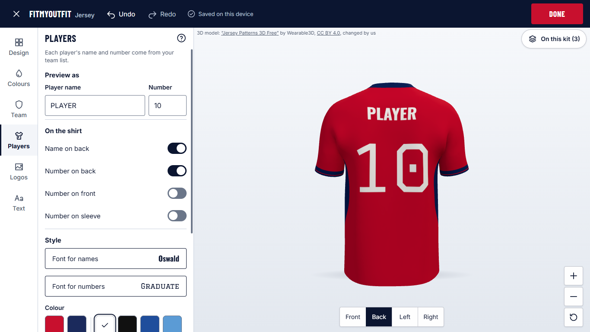

# 08 Team list in the editor: specification

17 Nov 2026 · storefront-designer · task "design the team list". For the developer who builds editor step E4 (`packages/editor`) and for the storefront developer who saves the list (M3, "Team list in the editor").

**Why this file exists.** On 17 Nov 2026 the founder changed the ordering flow: players no longer add their own details through a link; the person placing the order enters every player's name, number and size in one list inside the editor ([decision 012](../decisions/012-team-list-entered-by-the-organizer.md)). This file specifies that list. It joins what editor step E4 ("roster preview") was going to build. It follows direction A ([03-direction.md](03-direction.md)), the editor specification ([06-editor.md](06-editor.md)) and the rules of the review ([07-editor-review.md](07-editor-review.md) section 4). Nothing here sets a price, a date, a minimum or a promise: where one is needed it says **copy from founders** or uses the existing placeholder (export minimum 10). Every sentence for the customer is **draft wording**, collected in [section 15](#15-draft-wording-founders-to-confirm).

**How to read this file.** Section 0 says what "good" means as checks. Section 1 is the research. Section 2 is the editor today. Sections 3 to 11 are the design, from where the list lives to what happens after it. Section 12 is the data the editor hands to its host. Section 13 covers the hard states. Section 14 is the look and the components, 15 the wording, 16 the checklist, 17 the decisions and questions, 18 the sources.

Contents:
0. [What the list must do, made checkable](#0-what-the-list-must-do-made-checkable)
1. [Research: how other builders take a team list](#1-research-how-other-builders-take-a-team-list)
2. [The editor today](#2-the-editor-today)
3. [Where the list lives](#3-where-the-list-lives)
4. [A line, and entering 20 players fast](#4-a-line-and-entering-20-players-fast)
5. [Pasting a list, and a CSV file](#5-pasting-a-list-and-a-csv-file)
6. [The checks, beside the line](#6-the-checks-beside-the-line)
7. [Seeing each player's jersey](#7-seeing-each-players-jersey)
8. [The whole team at a glance](#8-the-whole-team-at-a-glance)
9. [Designs without a number or without a name](#9-designs-without-a-number-or-without-a-name)
10. [Extras: spare shirts, two shirts, a goalkeeper](#10-extras-spare-shirts-two-shirts-a-goalkeeper)
11. [After the list: saving, Done, before and after M3](#11-after-the-list-saving-done-before-and-after-m3)
12. [What the editor hands to its host](#12-what-the-editor-hands-to-its-host)
13. [Empty to 40 lines, slow devices, keyboard, screen readers, right-to-left](#13-empty-to-40-lines-slow-devices-keyboard-screen-readers-right-to-left)
14. [Look, measured sizes and components](#14-look-measured-sizes-and-components)
15. [Draft wording, founders to confirm](#15-draft-wording-founders-to-confirm)
16. [Review checklist](#16-review-checklist)
17. [Decisions for the coordinator, and open questions for the founder](#17-decisions-for-the-coordinator-and-open-questions-for-the-founder)
18. [Sources](#18-sources)

---

## Summary for the founder

**What changes for the organizer.** In the editor, the **Players** tab becomes the team list. The organizer types one line per player (name, number, size) or pastes the list they already have in WhatsApp or a spreadsheet. The shirt on screen shows the player whose line they are on, so every name and number is seen on the kit as it is typed. Problems show beside the line in words ("Same number as Bilal", "Too long for the back"), and one button jumps to the next line that needs a look.

**What it looks like.**
- **Phone:** the list fills the lower 60% of the screen; above it the back of the shirt, zoomed in on the name and number, changes as each letter is typed. Under the shirt, "‹ 10 · ALI RAZA ›" steps through the players. While the keyboard is open, the shirt keeps a strip at the top and the line being typed sits just above the keyboard.
- **Computer:** the list is a 480 px column beside the shirt; the shirt fills the rest.
- **Fast entry:** Enter (the phone keyboard's "Next") moves from name to number to size to the next player's name. Sizes can be typed ("m", "xxl") or tapped in a row of size buttons above the keyboard.
- **Pasting:** "Paste a list" reads lines such as `10 Ali Raza M`, `Ali Raza, 10, M` or a block copied from Excel, shows what it understood line by line, and adds nothing until the organizer presses "Add 18 players".
- **At a glance:** a bar at the top of the list says "20 players · 2 to fix"; opened, it shows how many of each size, and, for export orders below the minimum, how many more are needed.

**Until team orders exist (M3)** the list is saved on the phone or computer with the design, as the design is today, and "Done" still saves and goes back. When team orders exist, "Done" leads on to the proof, and the same list is saved to the order.

**What I recommend that needs a yes** (section 17): keep the list inside the Players tab rather than as a separate screen; allow a spare shirt with no name and a "2 of this shirt" count per player; leave goalkeeper and coach kits in another colour out of the first version (they are a second design).

---

## 0. What the list must do, made checkable

The founder's standing words for the editor are "more easy and dynamic and modern" than Spized's configurator, and phone first. For the team list they become these checks. Each can be timed, counted or seen in a screenshot.

| # | Check | How it is checked | Basis |
| --- | --- | --- | --- |
| TL1 | On a 390 × 844 phone, an organizer types **20 players** (name, number, size) from a paper list in **under 6 minutes**, without help and without leaving the keyboard except to tap sizes | Timed user test, 5 organizers, median | dev-plan M3 "Done when": "the organizer enters 20 players in the editor", on a phone. The time is my target (opinion) |
| TL2 | Pasting a 20-line WhatsApp list, checking it and adding it takes **under 1 minute** | Timed test with the sample texts in 5.5 | Opinion |
| TL3 | Every problem is shown **beside its line, in words**, and one action reaches the next problem from anywhere in a 40-line list | Screenshots; count actions | NN/g and GOV.UK place errors next to the field (section 1.3) |
| TL4 | Choosing a line shows that player's name and number on the model within **100 ms** (p75, mid-range phone) | Performance marks | 06-editor DY1 |
| TL5 | No error appears **while the organizer is still typing** a value that could become right; an error **clears on the keystroke** that fixes it | Type each case in 6.2 | Baymard and NN/g on premature validation (1.3) |
| TL6 | With the keyboard open on a 360 × 640 phone, the line being typed, its message and the shirt's name and number are all visible at once | Screenshot with the keyboard open | 06-editor 3.3 (typing) |
| TL7 | The whole flow works with a keyboard alone and with a screen reader, and every line, field and message has a name | Keyboard walk-through; accessibility tree | WCAG 2.2 (06-editor 1.6) |
| TL8 | Nothing in the list is told by colour alone: missing, wrong and fine lines differ by shape and words | Greyscale screenshot | 06-editor 11.2 |

---

## 1. Research: how other builders take a team list

All sources were opened on **17 Nov 2026** with a web-fetch tool, which returns a page's text, not a picture. I did not sign in, add anything to a cart, submit a form, or open a configurator in a browser. Where a list can only be seen inside a cart or an account, I say so and stop there. Where a fetch summarised rather than quoted, the claim below keeps to what it reported and is marked "(summary of the page)".

### 1.1 The teamwear builders from 06-editor section 1

**Spized** (the founder's reference)
- **Evidence:** names and numbers can be entered "directly in the configurator", in placeholder fields for number, name and initials; the number placeholder reads "99"; a preview opens from the bottom toolbar; "As an alternative", names and numbers can be entered together via **"Insert as team list" in the cart**; numbers may hold letters and some punctuation and are limited to **4 characters, "0" and "00" included**; initials to 4 characters (help article "Where and how can I add player names and numbers?", updated 27 Apr 2026, [source](https://spized.zendesk.com/hc/en-001/articles/7436083221789-Where-and-how-can-I-add-player-names-and-numbers); summary of the page).
- **Evidence:** "As soon as your design is ready, you can simply assign the order to a list." Team lists "are also saved in your account and can be shared, e.g. via a link", and "can also be used for further orders" (help article of 11 Jul 2024, [source](https://spized.zendesk.com/hc/en-gb/articles/20114773299357-I-want-to-order-several-jerseys-for-my-team-how-do-I-submit-the-sizes-and-names-I-need-printed)).
- **Evidence:** "You can either manually create a list or use our template and then upload it"; "You can also send the link with a deadline to individuals who still need to provide the required information"; the team list sits in the account under "Team list", outside the eight design steps; in step 8 "You can directly enter the size, name, and number" to preview ([ordering process](https://www.spized.com/en/ordering-process); partly summary of the page).
- **Evidence, from 12 Nov, not re-opened today:** the configurator's own text contains a team table with "Row", "Size" ("Which one fits?"), "Player Name", "Number", "Initials", "Quantity", "Edit" and "Add line" ([06-editor.md 1.1](06-editor.md#11-spized-the-founders-reference)).
- **Not seen:** what the table looks like, how a template upload is read, how errors show. The list lives in the cart and the account, which I did not open.

**owayo**
- **Evidence:** the soccer page says "Once you know the sizes you'd like, you can create the roster list for your order in our 3D Designer" and "place the draft in the 3D Designer shopping cart" ([owayo soccer](https://www.owayo.com/custom-soccer-jerseys.htm)).
- **Evidence:** the FAQ says to "create one draft with a single name and number as an example"; after the draft is in the basket the system will "walk you through the process of adding in the order details", "including quantities, sizes, individual texts/numbers and addresses"; production starts only "after receiving your written approval/authorisation"; there is no minimum per size; for sizing it recommends a 14-day viewing sample and a try-on session ([owayo soccer FAQ](https://www.owayo.com/soccer/faq.htm); summary of the page with quotes).
- **Evidence:** "you can assign individual texts to each item" once the item is in the cart; "For a run of 10 t-shirts, for example, add individual names, numbers or quotes for each article" ([owayo unique team design](https://www.owayo.com/productservice/unique_teamdesign-us.htm)).
- **Not seen:** the cart step itself. The two owayo pages place the list differently ("in our 3D Designer" against "in the cart"); probably the designer's own cart, but the pages don't say.

**Kukri**
- **Evidence:** step 6 "Size and players": "Select your sizes and players details, 'Add Kitbag to Basket' to create your order details"; step 4 "Personalise": "adding your logo, name and number" ([Kukri kit designer](https://www.kukrisports.co.uk/kit-designer)). Nothing about uploading or sharing a list.

**Admiral** (not re-opened today): design, save in the "Locker Room", share "for internal review", submit ([06-editor.md 1.3](06-editor.md#13-other-teamwear-builders)). Its pages, as read on 12 Nov, did not describe a team list.

### 1.2 Other builders with a list next to the design

- **Sublimation Kings** puts the list on the product page: an "Add Player Details" section with "Name", "#", "C/A", "QTY", a "Select" size menu from Youth-S to G-5XL, and "+ Add Player"; "Player names and numbers are included at no additional cost on products that allow for them"; "Simply provide your roster information during the ordering process" ([product page](https://sublimationkings.com/?p=214425); field types are not stated on the page; "C/A" is not explained, probably captain and assistant: my guess).
- **Madegood Designs, Jersey Maker** takes a pasted roster: the box is labelled "One player per line: name, number, size", the example is "Rivera, 9, M"; commas, semicolons or tabs separate the fields; number and size may be blank; up to **60 players**; **names are cut to 16 characters**; repeated numbers are flagged; a number outside 0 to 99 is flagged with its line number ("00 is allowed"); players are counted per size; **tapping a row previews that player's name and number on the jersey**; the size only switches with the spellings YS, S, M, L, XL or XXL, while the size menu says "Youth" and "2XL" ([Jersey Maker](https://madegooddesigns.com/?p=136831); summary of the page, which was longer than the fetch could read: the last 13,000 characters were not read).
- **Product Designer App, "Teams & Numbers"** (a configurator sold to shops): per member "Product Size", "Quantity", "Assigned Name", "Assigned Jersey Number"; "customers can edit the member list at any time before adding the product to the cart"; "Changes are applied immediately to the corresponding design elements in the Design Studio" ([documentation](https://docs.productdesignerapp.com/docs/teams-numbers/); summary with quotes).
- **Exclaim** (team rosters): rosters "save and manage individual apparel details, including sizes, names, numbers, aliases, and flags"; **adding a Name element to the design "makes a name field available in the roster"**; a blank name means "no name is printed for that person and the NAME placeholder is removed"; rosters are reused for later orders; the page advises checking spelling, sizes, quantities and blank fields before ordering, because "Submitting an order authorizes production according to the supplied details" ([Exclaim team rosters](https://exclaim.gg/features/ordering/team-rosters); summary with quotes).
- **Wooter** (article of 10 Mar 2026): the usual problems are "Wrong sizes. Duplicate numbers. Missing names."; names "Exactly as it should appear on the jersey"; sizes collected through "group chats or DMs" go wrong; "One document, one owner" ([Wooter article](https://wooter.com/articles/?p=18468)).

**Not reached:** RushOrderTees' help article on names and numbers failed with an SSL error; Kit Designer Pro's roster article answered 404; adidas custom's "Quick Count Roster" article answered 403. I did not use other copies of them.

### 1.3 Usability research and standards used here

- **Errors next to the field** (NN/g, Rachel Krause, 3 Feb 2019, reviewed 12 Dec 2024): "In most cases, avoid showing an error until the user has finished with the field and moved to the next field"; "It's frustrating to see an error message before being given the opportunity to finish typing"; show "an actionable error message below or next to the problem field"; a summary at the top "shouldn't be used as the only form of error indication, as it forces the user to search for the field in error"; an icon helps colour-blind users ([NN/g](https://www.nngroup.com/articles/errors-forms-design-guidelines/)).
- **Inline validation** (Baymard, Edward Scott, 9 Jan 2024): "overly aggressive premature validation negatively impacts the overall experience"; check when the user has been able to "fully type a correct input" (on leaving the field, or at the expected length for fixed-length fields); the error must "live update on a keystroke level", gone "the moment users enter a valid input"; a check mark next to correct values helps ([Baymard](https://baymard.com/blog/inline-form-validation)).
- **GOV.UK Design System, error message:** "explain what went wrong and how to fix it"; "Use the same message next to the field and in the Error summary"; a hidden "Error:" before the message for screen readers ([GOV.UK](https://design-system.service.gov.uk/components/error-message/)).
- **`enterkeyhint`** names the phone keyboard's Enter key; `next` is "Typically taking the user to the next field that will accept text"; `done` closes the keyboard; Baseline "Widely available" since November 2021 ([MDN](https://developer.mozilla.org/en-US/docs/Web/HTML/Reference/Global_attributes/enterkeyhint)).
- From 06-editor (not re-opened today): bottom sheets and stacking (NN/g), `interactive-widget=resizes-content` (MDN), WCAG 2.2 target size and dragging alternatives, reduced motion.

### 1.4 What this means for us

**Evidence, summed up:**
- Spized, owayo and Kukri take the per-player list **after** the design: in the cart (Spized's "Insert as team list", owayo's basket step, Kukri's "Add Kitbag to Basket") or in the account (Spized). Spized also lets the organizer share the list with a link and a deadline; we do not, at launch (decision 012).
- Only the smaller tools put the list **beside** the design with a per-player preview: Madegood ("tapping a row previews that player's name and number") and Product Designer App ("Changes are applied immediately … in the Design Studio").
- Pasting a roster as text exists (Madegood: one player per line, comma, semicolon or tab); a template upload exists (Spized). None of the pages I could read shows what happens to a line that can't be read.
- Fields follow the design in Exclaim (a name field appears when a name is on the design).

**Failures to avoid (evidence of the behaviour; the judgement is opinion):**
- **Names cut silently** (Madegood cuts at 16 characters). We never shorten a name: we say it is too long and the organizer decides.
- **Spellings that don't match** (Madegood's size menu says "2XL" but only "XXL" switches the size). We accept the common spellings of every size (4.5).
- **The list away from the shirt** (Spized's cart and account, owayo's basket). The coach can't see "MUHAMMAD ABDUL REHMAN" squeezed on the back until the proof. Ours shows each line on the model as it is typed.
- **The preview hidden** (Spized: behind "Edit", after saving, 06-editor 1.1). Ours is the list itself.

**For us (opinion):** the list belongs inside the editor, next to the live shirt, which is what the founder asked for and what only the smaller tools do. Typing and pasting are both first-class; the checks are the shared roster rules, shown beside the line; and the size words are forgiving.

---

## 2. The editor today

**Method.** On 17 Nov 2026 I opened the running editor (http://localhost:5183, `master`) in headless Chrome with real device emulation (`Emulation.setDeviceMetricsOverride` with `mobile: true`, scale 2, touch on, an Android user agent) at **390 × 844**, and as a desktop at **1366 × 768**, for the jersey and the T-shirt (`?product=stand-in-tshirt`). A phone keyboard can't be opened in emulation: as a stand-in I shrank the visible height to 464 px (55%) with a name field focused, which the page's `interactive-widget=resizes-content` treats the same way (the page reported that viewport setting). Pictures are of our own editor.



*Phone, Players open at its normal height (232 px panel): "Preview as" with one name and one number. The garment is 251 × 328 px in a 492 px free stage (fill 0.67).*



*Phone with the keyboard stand-in: the dock is hidden, the panel shrinks to 175 px, the camera zooms on the back, and the 29-character name shrinks to fit (W-ED78 "Long names get smaller to fit.").*



*Desktop: the 360 px panel holds the sample player, the switches and the style.*

**Evidence (measured in the page):**
- The Players panel holds, in order: the line "Each player's name and number come from your team list." (W-ED71), "Preview as" (Player name, Number), "On the shirt" (four switches), "Style" (fonts, colour, outline, size), "Digits". At 390 × 844 the panel is 232 px at normal height and 506 px expanded (60%); the stage above it is then 218 px.
- With a field focused and the keyboard stand-in, the dock disappears and the panel becomes 175 px; the stage is 233 px.
- The Done panel says "Nothing to check. Your kit looks ready.", "SAVE AND GO BACK" and "Team orders open soon. Your design is saved on this device."
- There is one sample player in the design (`samplePlayer`: name and number), not a list.

**What stays (opinion):** the camera turning to the back when Players opens; the zoom onto the item being typed; names shrinking evenly; Urdu and Arabic shaping on the model (the Urdu sample "محمد علی" renders correctly on the T-shirt).

---

## 3. Where the list lives

### 3.1 Decision for the coordinator (D-TL1): the list is the Players tab

Three places were considered. All three keep the editor's six tabs, the one red "Done" and the rule "one panel at a time" (06-editor 3.2, 3.3).

| | A. **The Players tab is the team list** (recommended) | B. A separate step after "Done" | C. A full-screen sheet from a top-bar button |
| --- | --- | --- | --- |
| What the organizer sees | The Players tab opens on the list; the name and number style move one level down ("Style ›") | "Done" opens a list screen with a small preview; "Back to design" returns | A "Team" button in the top bar opens a sheet over the editor with a small preview |
| The live shirt | Always beside the list (phone: above it; desktop: beside it) | A thumbnail, or the stage shrunk to a strip | Covered by the sheet, except a thumbnail |
| Back to designing | Tap any other tab; the chosen player stays on the shirt | "Back to design" | Close the sheet |
| Cost | Reuses the panel, the dock, the camera framing and the keyboard rule | A second layout of the whole editor | A second panel system; NN/g warns against hiding content behind sheets (06-editor 1.6) |
| Risk | The list is one panel among six; it must be found | Organizers who think in "design, then players" find it at once | The top bar at 360 px has no room left (06-editor 3.6) |

**Recommendation: A.** The founder asked for "a single editor"; A is the only option where every line is seen on the full-size shirt while it is typed, which is what makes the list better than Spized's cart table (1.4). B's clear "next step" is kept by the Done panel, which says how many players are in the list and leads to it (11.2). C is rejected: there is no room in the phone's top bar, and a sheet over the shirt hides the one thing the list is for.

**What the Players tab holds, under A:**
- **Team list** (the default view): the summary bar, the toolbar (Paste a list, Sort, Style), the lines, "Add a player".
- **Style ›** (a sub-view with "‹ Back", as 06-editor 3.3 allows): "On the shirt" switches, fonts, colour, outline, size, digits. These are set once; they were the Players panel's content until now. "Preview as" (the sample player) is shown here only while the list is empty (7.3).
- The tab keeps its word, "Players" (06-editor Q-D8).

### 3.2 Phone (compact layout), list open, no keyboard

Drawn at **390 × 844** CSS px. Measured positions are from today's build (section 2); new parts are specified.

```
COMPACT · Players · team list                                 390 x 844
+--------------------------------------------------------------+  y 0
| [X]  [<-] [->]          (v) Saved          [    DONE    ]    |  56  top bar
+--------------------------------------------------------------+  y 56
| 3D model by Wearable3D, CC BY 4.0, changed           [=3]    |  24  credit + kit button
|                  |        A L I   R A Z A        |           |
|                  |             1 0               |           |  back close-up:
|                  |                               |           |  name + number fill
|          [ <  ]  10 · ALI RAZA  [  > ]          [[ ]]        |  44  player pill · whole-shirt toggle
+------------------------------ ==== --------------------------+  y 274
| PLAYERS                                         [?]   [v]    |  48  header
| [v 20 players · 2 to fix   ]       [Next to fix >]   [ + ]   |  48  summary bar (sticky)
| [Paste a list]   [Sort v]                       [Style >]    |  44  toolbar
| [ Ali Raza                 ] [ 10 ] [ M   ]  [...]           |  56  line (chosen: tinted, bar)
| [ Bilal Ahmed              ] [  7 ] [ L   ]  [...]           |  56
| [ محمد علی                 ] [ ٧  ] [ XL  ]  [...]           |  56  wrong: number
|  (!) Same number as Bilal Ahmed (7).                         |  22  message
| [ Usman Tariq              ] [ 23 ] [ Needs a size ]  [...]  |  56  incomplete: dashed
| [ Hamza                    ] [  4 ] [ S   ]  [...]  ...      |  rows scroll; end fade
+--------------------------------------------------------------+  y 780
| Design | Colours |  Team  | Players*| Logos  |  Text         |  64  dock
+--------------------------------------------------------------+  y 844
```

- **Panel height:** the list opens at the expanded detent: `min(60% of the visible height, visible height − 56 − 64 − 160)`. At 390 × 844 that is 506 px (as measured today), leaving the stage 218 px. At 360 × 640 it is 360 px and the stage keeps its 160 px minimum. Dragging the grab strip down, or "Show less", gives the normal height (232 px: header, summary bar and the chosen line).
- **Stage in list view (compact):** the view buttons (Front, Back, Left, Right) and the zoom pair are hidden; the bottom row holds the **player pill** (7.2) centred in the free stage, and a **whole-shirt toggle** (44 × 44, "Show the whole shirt" / "Zoom to name and number", `aria-pressed`) at the end. The credit line and the "On this kit" button stay at the top (07-editor-review 4.7). Turning the shirt by dragging still works; the toggle returns to the framing.
- **Camera:** opening the list turns to the back (06-editor 6.3) and frames the **back close-up**: the box around the name and number on the back plus 12% on every side, filling 80% of the free stage's height. The free stage at 390 × 844 is 218 − 24 − 52 = 142 px, so the name and number together are about 114 px tall. Choosing another line does not move the camera (only the letters change).
- **Rows:** 56 px (48 px fields, 8 px gap). Columns at 390: name 174, number 56, size 64, more 44, with 8, 8 and 4 px gaps (sizes in 14.2). Six rows show; the list scrolls inside the panel with the summary bar stuck at its top, and a 16 px fade at the bottom while there is more (07-editor-review R39).

### 3.3 Phone with the keyboard open

The phone keyboard takes 40 to 50% of the screen. The visible area is then about **390 × 470** (drawn) and **360 × 380** on the smallest phone. The viewport's `interactive-widget=resizes-content` (in place today) makes the layout shrink with it. While a list field has focus:

- the dock hides (as today);
- the panel's grab strip, header and toolbar hide; the summary bar shrinks to **40 px** and reads "Player 4 of 20 · 2 to fix";
- the **stage keeps `clamp(120 px, 32% of the visible height, 200 px)`**: 150 px at 470, 122 px at 380. It shows the back close-up of the chosen line, with no pill and no toggle; the credit line stays (the model's licence asks for it wherever the model is shown, decision 009);
- the rows fill the rest; **the line being typed is kept fully in view, with its message, directly above the keyboard (or above the size strip)**, so the lines typed just before it show above it, like a chat;
- when the size field has focus, the **size strip** (4.5) sits on top of the keyboard, 52 px.

```
COMPACT · typing a size, keyboard open                         390 x ~470 visible
+--------------------------------------------------------------+  y 0
| [X]  [<-] [->]          (v) Saved          [    DONE    ]    |  56
+--------------------------------------------------------------+  y 56
| 3D model by Wearable3D, CC BY 4.0, changed                   |
|                     U S M A N   T A R I Q                    |  150  stage: back close-up
|                             2 3                              |       of the chosen line
+--------------------------------------------------------------+  y 206
| Player 4 of 20 · 2 to fix                     [Next to fix >]|  40  summary bar, short
| [ Bilal Ahmed              ] [  7 ] [ L   ]  [...]           |
| [ محمد علی                 ] [ ٧  ] [ XL  ]  [...]           |  earlier lines
|  (!) Same number as Bilal Ahmed (7).                         |
| [ Usman Tariq              ] [ 23 ] [ m|  ]  [...]           |  56  line being typed
+--------------------------------------------------------------+  y 418
| [YS][YM][YL][YXL] [XS][S][M*][L][XL][2XL][3XL] [Size chart]  |  52  size strip, scrolls
+--------------------------------------------------------------+  y 470
|                       phone keyboard                         |
```

**At 360 × 380 visible:** top bar 56, stage 122, summary 40, size strip 52 (only on the size field), rows 110: the line being typed, its message and half of the line before. That is the floor (TL6).

**Leaving the keyboard:** the keyboard's own hide key, Back, a tap on the stage, or **Enter on an empty new line** (4.3) close it. The panel then returns to the list height, the dock comes back, and the chosen line stays chosen.

**Phone in landscape (short layout, 844 × 390):** the list is the 320 px side panel (06-editor 3.4) widened to **400 px** in list view; the stage keeps 380 px to its left with the back close-up. Typing in landscape leaves only a strip; it works, but the organizer is better off in portrait (opinion; the same compromise as 06-editor 3.4).

### 3.4 Desktop (wide layout)

Drawn at **1366 × 768**. The Players panel is **480 px wide in list view** (360 px in Style and in every other tool), so a name has room; the stage is 798 px.

```
WIDE · Players · team list                                                              1366 x 768
+------------------------------------------------------------------------------------------------------------+
| FITMYOUTFIT Jersey   [<- Undo] [Redo ->]  (v) Saved on this device                                [ DONE ] |  64
+-------+-------------------------------------------------+--------------------------------------------------+
| [::]  | PLAYERS                                     [?] | credit …        [<  10 · ALI RAZA  >]    [=] (3) |
|Design | 20 players · 21 pieces · 2 to fix [Next to fix>]|                                                  |
| [##]  | YS 0 · YM 0 · YL 1 · YXL 2 · XS 0 · S 3 · M 6   |              .------.  .------.                  |
|Colours| L 5 · XL 2 · 2XL 1 · 3XL 0 · No size yet 1      |             /                  \                 |
| [T]   | [Paste a list]  [Sort v]            [Style >]   |            |    A L I  R A Z A   |                |
| Team  | #   Name                      No.   Size        |            |        1 0          |   back view    |
| [10]  |  1  [ Ali Raza             ] [ 10 ] [ M  ] [..] |            |                     |                |
|Players|  2  [ Bilal Ahmed          ] [  7 ] [ L  ] [..] |             \__________________/                 |
| [img] |  3  [ محمد علی             ] [ ٧  ] [ XL ] [..] |                                                  |
| Logos |     (!) Same number as Bilal Ahmed (7).         |                                          [ + ]   |
| [Aa]  |  4  [ Usman Tariq          ] [ 23 ] [Needs a size] [..]                                [ - ]   |
| Text  |  5  [ Hamza                ] [  4 ] [ S  ] [..] |      [ Front ] [ Back* ] [ Left ] [ Right ] [ o ]|
|       |  …  rows scroll; summary and headings stay      |                                                  |
|       | [ + Add a player ]                              |                                                  |
+-------+-------------------------------------------------+--------------------------------------------------+
  88 px rail · 480 px panel · 798 px stage
```

- **Panel parts, top to bottom:** header 56 (title, "?"); the **summary block** (8.1), open by default when the panel is at least 640 px tall, otherwise a 48 px bar like the phone's; the toolbar 44; a **column heading row** 32 px ("#", "Name", "No.", "Size"; `label` type, sticky under the summary); the lines (52 px: 44 px fields, 8 px gap); "+ Add a player" after the last line.
- **Stage:** the whole back at the rest framing (07-editor-review 4.6: 75 to 80% of the free stage), the **player chip** at the top centre of the free stage (7.2), the view buttons and zoom as usual. On a desktop the stage is large enough that a close-up is not needed (opinion).
- **1366 × 600** (the founder's own window, about 1420 × 612 at his 1.35 scale, 07-editor-review section 2): the summary is the 48 px bar; about 6.5 lines show. **1280 × 720:** the stage is 712 px wide; nothing else changes.
- **Tablet (820 × 1180, compact):** as the phone, with the panel content in the centred 560 px column, header included (07-editor-review 4.1); rows show the "#" column (there is room).

### 3.5 Getting there, and back to designing

| From | Action | Lands on |
| --- | --- | --- |
| Any tool | The **Players** tab (dock or rail) | The list, at the line chosen last; on compact at the list height |
| The stage chip in any other tool (7.2) | Tap its middle part | The list, with that line chosen and scrolled into view |
| The Done panel | "Team list: 18 players · 2 to fix" → **Show** (11.2) | The list, at the first line to fix |
| The list | Any other tab | That tool; **the chosen player stays on the shirt**, so the coach designs with a real name and number |
| The list | Style › | The Style sub-view; "‹ Back" returns to the list at the same scroll position |

The list remembers its scroll position and its chosen line for the visit. The camera turns to the back only when the Players tab is opened, never while lines are chosen (06-editor 6.3: the camera moves only in answer to an action, and not within 1.5 s of the coach turning the shirt by hand).

---

## 4. A line, and entering 20 players fast

### 4.1 The fields of a line

One line is one player (one shirt, or more with "2 of this shirt", section 10). In the order the organizer types them, which is also the order on screen and the tab order:

| Field | Shown when | Input | Notes |
| --- | --- | --- | --- |
| **Name** | The design shows a player name (section 9) | `type="text"`, `dir="auto"`, `enterkeyhint="next"`, `autocapitalize="words"`, `autocomplete="off"`, `autocorrect="off"`, `spellcheck="false"` | Kept as typed. Phone autocorrect changes names (opinion, from use), so it is off |
| **No.** | The design shows a player number | `type="text"` (never `type="number"`: it drops "07" and refuses Arabic digits), `inputmode="numeric"`, `dir="ltr"`, `enterkeyhint="next"`, `autocomplete="off"` | Accepts 0–9, ٠–٩ and ۰–۹ as typed (06-editor 4.5; the rule in `jersey-number.ts`) |
| **Size** | Always | A combobox: `type="text"`, `role="combobox"`, `autocapitalize="characters"`, `enterkeyhint="next"`, `autocomplete="off"` | Typed or tapped (4.5). The product's sizes only |
| **More (⋯)** | Always | A 44 × 44 button | The line menu (4.6) |

**Clean-up on leaving a field (never while typing):** spaces at the start and end are removed, runs of spaces become one, the text is put in Unicode NFC (the design format requires it). The number keeps its leading zero ("07"). Nothing else is changed: no capitals added, nothing shortened.

### 4.2 What a line looks like

```
States of one line (compact, 390)                                     the line's accessible name
+--------------------------------------------------------------+
| [ Ali Raza             ] [ 10 ] [ M   ]  [...]               |  complete          "Player 1 of 20: Ali Raza, 10, M"
+--------------------------------------------------------------+
|#[ Ali Raza             ] [ 10 ] [ M   ]  [...]               |  chosen (on the shirt): surface-alt tint, 4 px ink bar
+--------------------------------------------------------------+
| [ Usman Tariq          ] [ 23 ] [ Needs a size ]  [...]      |  incomplete: dashed outline, words in the field
+--------------------------------------------------------------+
| [ Bilal Ahmed          ] [!10 ] [ L   ]  [...]               |  wrong: 2 px error outline, alert icon in the field,
|  (!) Same number as Ali Raza (10).                           |  the message under the line
+--------------------------------------------------------------+
| [ Muhammad Abdul Rehman Q] [ 9 ] [ XL  ]  [...]              |  fine, with a note: info icon, ink-muted,
|  (i) Prints smaller to fit.                                  |  not counted as a problem
+--------------------------------------------------------------+
| [ Name                 ] [ No.] [ Size ]  [...]              |  new and empty: placeholders only, no warnings
+--------------------------------------------------------------+
```

| State | When | Look | Counted as |
| --- | --- | --- | --- |
| **New, empty** | Just added | Fields with placeholders "Name", "No.", "Size" in `ink-muted` | Nothing; an empty line left behind is removed (4.3) |
| **Being typed** | Focus in the line | The focused field has the focus ring; nothing is flagged that could still become right (6.2) | — |
| **Complete** | Every shown field filled and every check passes | Plain fields (`border-strong` 1 px), no icon. No check mark per line: twenty ticks are noise; the summary says "all ready" (opinion, against Baymard's advice for single forms, 1.3) | "Ready" |
| **Incomplete** | A required field left empty, after the organizer has left the line | That field: **dashed** 1.5 px `border-strong` outline and its words inside, "Needs a name" / "Needs a number" / "Needs a size", in `ink-muted` | "To fix" |
| **Wrong** | A check fails (section 6) | That field: 2 px `error` outline and a 16 px alert icon at its end; under the line a message (`small` 13/18, `error`, alert icon), up to two lines | "To fix" |
| **Note** | A check passes with a remark (prints smaller; two alphabets) | Under the line, `small`, `ink-muted`, info icon | Not a problem |
| **Chosen** | It is on the shirt now | `surface-alt` row background, edge to edge of the panel, a 4 px `ink` bar on the start edge; combines with any state above | — |
| **Locked** | After the proof is signed (M3) | Fields read-only (`aria-readonly`), no ⋯; a line above the list says why (11.3) | — |

Missing and wrong are told apart by **shape and words**, not colour: dashed outline with "Needs a …" inside, against a solid thick outline with an icon and a sentence (TL8).

### 4.3 Typing 20 players without leaving the keyboard

**The Enter key** (the phone keyboard's "Next", from `enterkeyhint="next"`):

| Focus in | Enter does |
| --- | --- |
| Name | Moves to No. (or to Size when the design has no number) |
| No. | Moves to Size |
| Size | Chooses the highlighted size if the list of sizes is open; then moves to the **next line's Name**. On the last line it **adds a new line** first |
| Name of a new, still empty line | Removes that empty line and ends typing: on a phone the keyboard closes; on a desktop focus moves to "+ Add a player" |

So twenty players are: name, Next, number, Next, size, Next, twenty times. On a phone the keyboard switches between letters and digits as the fields change (`inputmode`); that is the platform's cost and can't be avoided without making the number a text field (opinion: worse).

**Desktop keys** (in addition):
- **Tab / Shift+Tab:** next and previous field, in the same order; Tab from Size goes to the line's ⋯, then to the next line's Name.
- **↑ / ↓** in Name or No.: the same field in the line above or below (as in a spreadsheet). In Size, ↑ and ↓ do the same while the size list is closed; **Alt+↓** opens the list; while it is open, ↑ and ↓ move in it (the ARIA combobox pattern).
- **Shift+Enter:** the previous field.
- **Esc:** closes the size list if open; otherwise puts back the value the field had when it got focus.
- **Ctrl/Cmd+Z** inside a field undoes typing in that field (the browser's own); outside a field it is the editor's undo (4.7).
- **Backspace in the Name of an empty line:** removes the line and moves to the end of the previous line's Size (like a notes app).

**What each key press does on the shirt:** the chosen line is the line with focus; every key press in Name or No. shows on the model at once (06-editor 4.5 does the same for the sample). Section 13.2 says what happens on a slow phone.

**Saving:** each change is in the list at once (the shirt and the summary follow); the list is handed to the host after 1 s without changes (section 12), as the design is. Each field change becomes **one undo step when the field is left**, labelled "Name of Ali Raza", "Number of Ali Raza", "Size of Ali Raza".

### 4.4 Adding lines

- **"+"** in the summary bar (44 × 44, accessible name "Add a player"): adds an empty line at the end, scrolls to it, focuses its Name. Always in view, because the summary bar is stuck to the top of the list.
- **"+ Add a player"** after the last line: a full-width button with a dashed `border-strong` outline, 48 px (44 on desktop). Same action.
- **Enter in the last Size** (4.3).
- **Paste** (section 5).
- An empty list shows the empty state (13.1) with "Add a player" and "Paste a list".
- **Limit:** 100 lines per list (a technical placeholder so the page stays quick; the coordinator sets the real one, 17.1). At the limit the add actions are inactive and say why: W-TL19.

### 4.5 The size control

**One field, two ways in: type it, or tap it.**

**Typing.** The field accepts the product's sizes and their common spellings, in any case, with or without spaces, and turns them into the product's size on leaving the field (or on Enter):

| Typed (examples) | Becomes |
| --- | --- |
| `ys`, `y s`, `y-s`, `youth s`, `youth small`, `yth s` | YS |
| `ym`, `youth m`, `youth medium` | YM |
| `yl`, `youth l`, `youth large` | YL |
| `yxl`, `youth xl` | YXL |
| `xs`, `x-small`, `extra small` | XS |
| `s`, `sm`, `small` | S |
| `m`, `med`, `medium` | M |
| `l`, `lg`, `large` | L |
| `xl`, `x-large`, `extra large` | XL |
| `2xl`, `xxl`, `2x`, `xx-large` | 2XL |
| `3xl`, `xxxl`, `3x` | 3XL |

The table is data from the host, built from the product's sizes (12.2), so a product with other sizes brings its own words. Anything else stays as typed and is flagged on leaving the field (6.1, W-TL62). Nothing is guessed from a partial word while typing; "x" alone is not "XL".

**Tapping (phone).** While the size field has focus, the **size strip** sits on top of the keyboard (3.3): one button per size of this product, in the product's order, 44 px tall and at least 44 px wide, 4 px apart, in two groups with an 8 px gap and a divider between Youth and Adult (the groups of the product page's size picker and size chart, 05-m1-pages 3.4). Then a **"Size chart"** text button. The strip scrolls sideways without a bar and with an end fade (07-editor-review 4.8); on opening it scrolls so the line's current size, or else **M**, is in view. Tapping a size fills the field and moves to the next line's Name, like Enter. The size that matches what is typed is pressed (`aria-pressed`, `ink` fill, white text): words and fill, not colour alone.

**Desktop.** The field is a combobox with a listbox under it (the sizes, grouped Youth and Adult, 36 px options, the typed text filtering them). The "Size chart" link sits at the end of the list's column heading "Size" (3.4).

**The size chart** is a host action (`openSizeChart(size)`, 12.3): in the store it opens the existing size chart sheet (05-m1-pages section 3) over the editor and returns focus to the size field when closed. **Until the host provides it, the "Size chart" button is not shown.** A size chart the organizer can send to players is a later task (decision 012).

### 4.6 The line menu (⋯)

A menu button at the end of every line (44 × 44, accessible name "More for Ali Raza"). On phones it opens a menu sheet in the panel area (one sheet at a time, 07-editor-review 4.10); on desktop a popover anchored to the button. Items, in order:

1. **Move up** · **Move down** (inactive at the ends)
2. **2 of this shirt…** (a stepper, section 10.2)
3. **No name on this shirt** · **No number on this shirt** (switches, section 10.1; shown only for the fields the design has)
4. **Remove** (in `error` colour with the bin icon; no confirmation, it can be undone)

### 4.7 Editing, removing, reordering and undoing

- **Edit:** tap a value and type. The line is chosen; the shirt shows it.
- **Remove:** from the ⋯ menu, or Backspace on an empty line (4.3). The line goes at once; the status line says "Removed Ali Raza · Undo" (W-TL15) for 6 s, its "Undo" restoring the line in its place. The next line becomes the chosen one.
- **Reorder:** Move up / Move down in the menu; **Alt+↑ / Alt+↓** on a desktop with focus in the line. No dragging: it is never needed, and dragging rows on a phone fights with scrolling (opinion; WCAG 2.5.7 requires a non-dragging way anyway).
- **Sort** (toolbar): "By number", "By name", "By size", "As entered" — a one-time reorder of the list, one undo step ("Sorted by number"). Lines without a number go last when sorting by number.
- **Undo and redo:** list changes share the editor's undo history and its top-bar buttons (06-editor 10.5): one step per field change, per removal, per move, per sort and per paste. The status line names the step ("Undone: Size of Usman Tariq"). One history, because the organizer has one pair of undo buttons in view and should not need to know which part of the editor a change belongs to (opinion; decision D-TL2).
- **Order matters:** the list's order is the order of the proof and of the bags in the box (opinion; the proof is specified in M3).

---

## 5. Pasting a list, and a CSV file

Most coaches already hold the list in a WhatsApp message or a spreadsheet (the brief; Wooter's article names group chats as where sizes go wrong, 1.2). Pasting is therefore a first-class way in, not an import buried in a menu.

### 5.1 Ways in

- **"Paste a list"** in the toolbar (3.2, 3.4), and in the empty state (13.1).
- **Pasting text that holds a line break or a tab into any list field** opens the paste view with that text already in it; the field keeps its old value. (A spreadsheet copy is tab-separated text; a WhatsApp message has line breaks.) A single line pastes into the field as usual.
- **"Choose a file"** inside the paste view (5.6).

### 5.2 The paste view

A sub-view of the Players panel with "‹ Back" (one panel at a time). On a phone it uses the list height; on a desktop the 480 px panel.

```
COMPACT · Paste a list, before pasting                         390 wide, panel area
+--------------------------------------------------------------+
| < Back                                                       |  44
| PASTE YOUR TEAM LIST                                         |  title
| One player per line: name, number and size, in any order.    |  body, ink-muted
| From WhatsApp, Excel or Google Sheets.                       |
| +----------------------------------------------------------+ |
| | Ali Raza 10 M                                            | |  placeholder shows
| | 7, Bilal Ahmed, L                                        | |  three example lines
| | محمد علی ٧ XL                                            | |  (ink-muted)
| |                                                          | |  textarea, 6 lines,
| +----------------------------------------------------------+ |  16 px, dir="auto"
| [ Paste ]   [ Choose a file ]                                |  44
+--------------------------------------------------------------+
```

```
COMPACT · Paste a list, after pasting 20 lines                  390 wide, panel area
+--------------------------------------------------------------+
| < Back                                                       |
| PASTE YOUR TEAM LIST                                         |
| Your text: 20 lines                              [Edit text] |  the box folds to one line
| WE READ 18 PLAYERS                                           |  section title
|  Ali Raza · 10 · M                                           |  40 px rows, read-only
|  Bilal Ahmed · 7 · L                                         |
|  محمد علی · ٧ · XL                                           |
|  (!) Same number as Bilal Ahmed (7).                         |
|  Usman Tariq · 23 · —                                        |
|  (!) No size found. You can add it after.                    |
|  …                                                           |  scrolls
| NOT ADDED (2)                                                |
|  "Squad for Saturday:"   Doesn't look like a player.  [Add]  |
|  "👍"                    Nothing to read.                    |
| (o) Add to the 4 players in the list                         |  only when the list
| ( ) Replace the list                                         |  is not empty
| [          ADD 18 PLAYERS          ]          Cancel         |  48, sticky at the bottom
+--------------------------------------------------------------+
```

```
WIDE · Paste a list, after pasting (480 px panel; the stage shows the first player read)
+-------------------------------------------------+
| < Back                                          |
| PASTE YOUR TEAM LIST                            |
| Your text: 20 lines                 [Edit text] |
| WE READ 18 PLAYERS · 2 NEED A LOOK              |
|  #   Name                 No.   Size            |  36 px rows, read-only
|  1   Ali Raza             10    M               |
|  2   Bilal Ahmed           7    L               |
|  3   محمد علی              ٧    XL              |
|      (!) Same number as Bilal Ahmed (7).        |
|  4   Usman Tariq          23    —               |
|      (!) No size found. You can add it after.   |
|  …                                              |
| NOT ADDED (2)                              [v]  |
| (o) Add to the 4 players in the list            |
| ( ) Replace the list                            |
| [ ADD 18 PLAYERS ]   Cancel                     |
+-------------------------------------------------+
```

- **The box:** a `textarea`, 6 lines tall on phones (8 on desktop), 16 px text (no zoom on focus in iOS Safari, opinion from common practice; not verified here), `dir="auto"`, spell checking off. The placeholder shows three example lines in three forms (W-TL31).
- **"Paste"** is shown only where the browser offers clipboard reading (`navigator.clipboard.readText`); it fills the box. If the browser refuses, the box gets focus and the hint reads "Press and hold in the box, then Paste." (W-TL33). Without the button the box works as any text box.
- **Reading is live:** 300 ms after the text last changed, the text is read (5.3) and the result shows under it. On a phone, a paste closes the keyboard (the box loses focus) so the result is in view; "Edit text" opens the box again.
- **Nothing changes in the list** until "Add 18 players" is pressed. "Cancel" and "‹ Back" leave the list as it was (the pasted text is kept for the visit, so going back is not a loss).
- **"Add 18 players"** (`ink` filled, the panel's main action; the red button stays "Done"): adds the lines in their pasted order at the end of the list (or replaces it, if chosen), as **one undo step** ("Undone: Pasted 18 players"), returns to the list, chooses the first added line and scrolls to it. Lines read with problems are added too and show their problems in the list, so nothing is lost and everything is fixed in one place.
- **"Replace the list"** appears only when the list already has lines; it is not the default. Choosing it changes the button to "Replace with 18 players".

### 5.3 How a line is read (for the roster rules module)

In plain words; the developer chooses the code. The same reader serves the paste box, CSV files and, later, the server (dev-plan M2: "A pasted list or a CSV upload from the organizer goes through the same checks").

1. **Split into lines.** Empty lines are skipped without a word.
2. **Remove decoration at the start and end of a line:** bullets (`•`, `-`, `*`, `–`), emoji and symbols, and a counting mark made of digits followed by `.` or `)` and a space (`1. `, `12) `). A copied WhatsApp message prefix such as `[10:42, 17/11/2026] Imran: ` is removed too.
3. **A header line:** if the first line holds only column words (name, player, number, no, no., #, shirt, size, qty, quantity, and the Urdu نام, نمبر, سائز), it is not a player: it sets the order of the columns for the lines below and is listed as "Used as column names".
4. **Split into parts:** by tabs if the line has a tab (a spreadsheet); else by commas, semicolons or `|`; else by spaces.
5. **Recognise each part by what it looks like:**
   - **a size:** a part (or, without separators, a word at the start or the end of the line) that is one of the size words of 4.5. "Ali S Khan M" gives the name "Ali S Khan" and the size M;
   - **a number:** one or two digits of one digit system, alone, or after `#` or `No.` (`#7`, `No. 7`);
   - **a quantity:** `x2`, `×2`, `2 pcs`, `qty 2` (only if 10.2 is accepted);
   - **the name:** everything else, in order, joined with single spaces.
   - With a header line, parts take their column instead.
6. **Never guess.** When a line can be read in two ways, it is added with the uncertain field empty and a message:
   - two numbers ("7 Ali 10 M"): number empty, "Two numbers here: 7 and 10. Type the shirt number." (W-TL37);
   - a three-digit number or a size this product doesn't have: kept as written and flagged by the normal checks (section 6).
7. **Lines that are not players** are listed under "Not added", with their text and a reason, and an **"Add"** button that adds them as a line with the text as the name, to be fixed:
   - no number, no size, and a colon at the end or more than 5 words ("Squad for Saturday:"): "Doesn't look like a player." (W-TL38);
   - nothing left after step 2 ("👍"): "Nothing to read." (W-TL39), without "Add".
8. **The checks of section 6 run on the result**, against the lines already in the list too (a pasted 7 that clashes with an existing 7 shows "Same number as …" in the result).
9. **Limits:** up to the list limit (4.4); past it, the result says how many fit and adds only those (W-TL40).

### 5.4 What is shown before it is accepted

- A count, as a section title: "We read 18 players" (W-TL34), plus "2 need a look" when some lines have problems.
- One read-only row per player, 40 px, `body`: name · number · size, with "—" for an empty field (read as "no size" by screen readers), names in `<bdi>`. Rows with a problem carry the alert icon and the message under them, worded exactly as in the list (GOV.UK: the same message in both places, 1.3).
- "Not added (n)", collapsed when n is 0.
- "Used as column names: Name · No. · Size", when a header was found.

### 5.5 Sample texts for testing the reader

| Source | Text | Read as |
| --- | --- | --- |
| WhatsApp, numbered | `1. Ali Raza 10 M` | Ali Raza · 10 · M |
| WhatsApp, number first | `10 - Ali Raza - M` | Ali Raza · 10 · M |
| Commas | `Bilal Ahmed, 7, L` | Bilal Ahmed · 7 · L |
| Excel copy (tabs, header) | `Name⇥No⇥Size` then `Usman Tariq⇥23⇥xl` | header used; Usman Tariq · 23 · XL |
| Urdu name, Arabic digits | `محمد علی ٧ XL` | محمد علی · ٧ · XL |
| Hash and words | `#4 Hamza small` | Hamza · 4 · S |
| Size first | `M Ali Raza 10` | Ali Raza · 10 · M |
| Initial in the name | `Ali S Khan 9 L` | Ali S Khan · 9 · L |
| Two numbers | `7 Ali 10 M` | Ali · (empty) · M, "Two numbers here" |
| No size | `Imran 5` | Imran · 5 · (needs a size) |
| Not a player | `Squad for Saturday:` | Not added |
| Size not made | `Zain 11 4XL` | Zain · 11 · 4XL, flagged "We don't make 4XL" |

### 5.6 A CSV file

- **"Choose a file"** in the paste view: `accept=".csv,.tsv,.txt,text/csv,text/plain"`, up to 200 KB (thousands of lines; a placeholder).
- The file is read as **UTF-8** (a byte-order mark is dropped); if that fails, as **UTF-16** (Excel's "Unicode Text"); if both fail: "We can't read this file. In Excel choose Save As › CSV UTF-8, or copy the cells and paste them here." (W-TL42). Excel's older "CSV" format stores Arabic and Urdu letters in a code page that turns them into question marks; the UTF-8 message covers that case.
- Commas inside quotes stay in the field (`"Raza, Ali",10,M`), the usual CSV quoting.
- The file's text is put into the box and read exactly like a paste (5.3); the result is shown the same way and nothing is added until "Add … players".
- **Excel files (.xlsx) are not read.** Reading them needs a library and a parser for a large format; copying the cells gives the same result with no new dependency (opinion, following the editor's "no new libraries" rule, 06-editor 13). The hint says so (W-TL41).

---

## 6. The checks, beside the line

The rules are already decided (decision 012 point 3; dev-plan M2): no duplicate numbers, no blank required fields, allowed characters, a maximum length from the font and the print area, and the jersey number rule. They live in **one roster-rules module** used by the editor (to show a problem beside its line) and by the backend (to refuse a bad list); **the server's check is the one that counts**. This section says how each one reads and where it shows. Wording is draft (section 15).

### 6.1 The checks

| Code (for the module) | Rule | Shown | Words beside the line (draft) | Blocks the proof (M3) |
| --- | --- | --- | --- | --- |
| `name-missing` | The design shows a name, the line is not "No name", and the name is empty | After the line is left (6.2) | In the field: "Needs a name" (W-TL50) | Yes |
| `number-missing` | The design shows a number, the line is not "No number", and the number is empty | After the line is left | In the field: "Needs a number" (W-TL51) | Yes |
| `size-missing` | No size | After the line is left | In the field: "Needs a size" (W-TL52) | Yes |
| `number-not-digits` | A character that isn't a digit (a letter, a space inside, a sign) | At once | "Use digits only, from 0 to 99." (W-TL53) | Yes |
| `number-too-long` | Three digits or more, or above 99 (leading zeros count, as in `jersey-number.ts`) | At once | "Use 1 or 2 digits, from 0 to 99." (W-ED79) | Yes |
| `number-mixed-digits` | 0–9 mixed with ٠–٩ or ۰–۹ in one number | At once | "Use one kind of digits, not both." (W-ED80) | Yes |
| `number-duplicate` | Two or more lines have the same value: "7", "07", "٧" and "۷" are the same number | When the number field is left | On **each** line involved: "Same number as Bilal Ahmed (7)." With three or more: "Same number as Bilal Ahmed and 2 others (7)." (W-TL55) | Yes |
| `name-character` | A character outside the allowed set (below) | At once | "Can't print “★”. Use letters, spaces, and - ' ." (W-TL56); for a digit: "Numbers go in the No. box, not in the name." (W-TL57) | Yes |
| `name-font-letter` | A Latin letter the chosen name font doesn't have (for example ğ or Ł) | At once | "The name font has no “ğ”. Type “g”, or choose another font in Style." (W-TL58) | Yes |
| `name-too-long` | The name, at the style's size, would need to shrink below the **smallest allowed size** to fit its print box | At once (it can only get longer) | "Too long for the back: about 4 letters too many. Initials help: M. A. R. Qureshi." (W-TL59) | Yes |
| `name-smaller` (note) | The name fits only by shrinking, but stays at or above the smallest allowed size | At once | Note: "Prints smaller to fit." (W-TL60) | No |
| `name-mixed-scripts` (note) | Latin and Arabic-script letters in one name | When the name field is left | Note: "Mixes two alphabets. Check it on the shirt." (W-TL61) | No |
| `size-unknown` | Not one of this product's sizes, after the spellings of 4.5 | When the size field is left | "We don't make “4XL” in this jersey. Sizes: YS to 3XL." (W-TL62) | Yes |
| `quantity-range` | "2 of this shirt" outside 1 to 10 (placeholder) | Not reachable with the stepper; the server checks it | — | Yes |

**Allowed characters in a name (the rule, in words):** letters of the Latin alphabet, including accented letters the name font can print; letters of the Arabic script, including the Urdu letters (ٹ ڈ ڑ ں ے ہ ھ ک گ and the others) and their vowel marks; the space; the hyphen; the apostrophe (' and ’); the full stop. Nothing else: no digits, emoji or other symbols, no other scripts. Arabic-script names print in the Arabic fallback font when the name font is Latin only (06-editor 11.1, W-ED87).

**The smallest allowed size** comes from the print method and the factories. Until they give it, the placeholder is **75% of the style's size** (a name may shrink by a quarter). It is data in the rules module, not code (dev-plan placeholder rule). The width of a name is measured with the font's metrics (the engine already shrinks names evenly, N12 in 06-editor), so "too long" depends on the font, the letters and the print box, not on a count of characters. For the backend, the same measurement needs the font files; until it can run there, the server uses a fixed number (dev-plan M2), and the coordinator sets it (17.1).

**"About 4 letters too many"** is the excess width divided by the name's average letter width, rounded up. It is a hint, so it says "about".

**`0` and `00`** have the same value under today's number rule, so they count as the same number. (Spized allows both as separate numbers, 1.1.) I flag this in 17.1 rather than change a rule that is already decided.

### 6.2 When a check shows, and when it goes

The rule follows NN/g and Baymard (1.3): **never flag what the organizer can still be typing towards; always clear a problem on the keystroke that fixes it** (TL5).

- **At once, while typing:** problems that more typing can't fix: a character that isn't allowed, a third digit, mixed digits, a name already too long, a letter the font lacks.
- **When the field is left:** a duplicate number (the organizer may be about to change it), an unknown size (they may still be typing "xx…").
- **When the line is left:** missing fields. Moving from Name to No. never says "Needs a number". A new empty line is never flagged.
- **All at once** when "Next to fix" or Done is pressed: every missing field in the list is shown from then on, even on lines not yet visited.
- **Gone at once:** each message disappears on the keystroke that makes the value right. When one of two clashing numbers changes, both lines update.
- **On the shirt:** the model shows what would be printed: an invalid number is not drawn (the back shows no number, and the line says why), a character that can't be printed is left out, a long name is shown shrunk exactly as it would print. No error mark is drawn on the model.

### 6.3 Where a problem shows on a phone

- **On the field:** the outline (dashed for missing, a 2 px `error` line for wrong) and, for wrong, a 16 px alert icon at the field's end.
- **Under the line:** the message, starting 16 px in from the panel edge, full width, `small` 13/18 in `error` with the alert icon; notes in `ink-muted` with the info icon. At most two lines; longer wording is not allowed (15).
- **With the keyboard open:** the line being typed and its message are kept above the keyboard (3.3), so a message appearing as the organizer types is always seen.
- **In the summary bar:** the count, "2 to fix" (8.1).
- **Never** as a toast, a pop-up or only in the summary (NN/g: a summary alone "forces the user to search for the field in error", 1.3).
- **For screen readers:** the field gets `aria-invalid="true"` and `aria-describedby` pointing to the message, which begins with a hidden "Problem:" (GOV.UK's hidden "Error:", 1.3; W-TL63). Missing fields carry their "Needs a …" words in the description too, not only as placeholder text (placeholders are not reliably read).

### 6.4 Finding the next problem in a long list

- **"Next to fix ›"** in the summary bar, shown whenever there is at least one problem (W-TL12). It goes to the next line with a problem **after the chosen line**, wrapping to the top; it focuses that line's first problem field, scrolls it to a third of the way down the rows, chooses the line (the shirt shows it), and the message is announced (the field's description). On a phone with the keyboard closed it does not open the keyboard: focus goes to the line without the field taking text input until tapped (the line itself is focusable, 13.8).
- **"Only lines to fix"**, a switch in the summary details (8.1): the list shows only the lines with problems, with a bar "Showing 2 of 20 · Show all" (W-TL14). Fixed lines stay in view until the switch is turned off or the organizer leaves the list, so a line doesn't vanish under the finger (opinion).
- **Desktop:** F8 is "Next to fix", Shift+F8 the previous one (as in code editors; listed in the "?" help; opinion).
- **When nothing is left:** the bar shows "All ready" with a check icon in `success` (W-TL13), words and icon, not colour alone.

### 6.5 What the checks block

- **Before team orders exist (E4 alone):** nothing is blocked. The list saves with problems; Done reports them (11.2).
- **With team orders (M3):** the proof can't be made while any line has a problem marked "Yes" in 6.1, or while the export minimum isn't met (8.3). The **server** checks the list again and refuses it with the same codes, so the storefront can word a refusal exactly as the editor does. Notes never block.

---

## 7. Seeing each player's jersey

### 7.1 Choosing a line

- **A line is chosen** when any of its fields gets focus, when its free space is tapped, or by the player chip's previous and next buttons, "Next to fix", or a tap on the chip from another tool (3.5).
- **The shirt shows that player at once:** their name on every name position and their number on every number position (back, front, sleeve: whatever the design's "On the shirt" switches say), in the style set in Style. TL4: within 100 ms.
- **Choosing is not an edit:** it is not an undo step, it doesn't change the design, and it doesn't trigger "Saving…". The chosen line is part of the view, like the camera. (Today the sample player is stored in the design and every name and number item shows it, decision 009 "Added 12 Nov"; the chosen line is shown in its place without being written into the design. The developer chooses how.)
- **The chosen line is marked** in the list (`surface-alt` row and 4 px `ink` bar, 4.2) and named on the chip.
- **The camera does not move** when the chosen line changes (3.2). Section 6.2 says what the shirt shows for a line with a problem.

### 7.2 The player chip: stepping through the team

```
  [ <  ]   10 · ALI RAZA   [  > ]        44 px tall; < and > are 44 x 44
  [ <  ]   ٧ · محمد علی    [  > ]        number on the start side, name in <bdi>
  [ <  ]   10 · No name    [  > ]        a spare shirt (10.1)
  [ <  ] Sample · PLAYER 10 [  > ]       empty list (7.3); < and > inactive
```

- **Where:** in list view on a phone, at the bottom of the stage, centred in the free stage (3.2). In every other tool on a phone, and in every tool on a desktop, at the **top centre of the free stage** (06-editor 8.1). In the stage's top row it is the lowest in priority: the contextual bar, the status line, "Turn to edit" and the hint each take its place while they show (07-editor-review 4.7, "one of", in that order, then the chip). It is hidden while the keyboard is open.
- **Size:** 44 px tall, at most 224 px wide at 360 px (06-editor 4.8), up to 320 px on wide layouts; a long name is cut with an ellipsis **on the chip only**, never on the shirt. Look: the floating-control look of 07-editor-review 4.7 (`surface` at 96%, 1 px `rgb(11 21 48 / 0.24)`, small shadow), as a pill.
- **‹ and ›** choose the previous and the next line. They don't wrap: at the first and last line they are inactive (`aria-disabled`), so "1 of 20" and "20 of 20" are unmistakable (opinion).
- **The middle** opens the list at that line (from another tool), or, in list view, scrolls the list to the chosen line.
- **Keyboard (desktop):** with the stage focused and nothing selected, Page Up and Page Down choose the previous and next player (listed in the "?" help).
- **Accessible names:** the chip is a group "Player on the shirt"; the buttons "Previous player: Bilal Ahmed" and "Next player: Usman Tariq" (W-ED170 with the name); the middle "Ali Raza, number 10, size M. Show in the team list." After a step, the status line says "Player 4 of 20: Usman Tariq" (W-ED171), politely.
- **Three players without help** (the E4 "Done when" line): ‹ and › are always in view on the stage, so this is three taps.

### 7.3 When no line is chosen

**Only an empty list has no chosen line.** As soon as the list has a line, one is always chosen: the first line when the editor opens, the last chosen line when returning to the list, and after a removal the line that took its place (or the one before, at the end).

**With an empty list** the shirt shows the **sample player** from the design ("PLAYER" and "10" by default, W-ED72b), and the chip says **"Sample"** before it (W-ED72c), so nobody takes it for a real entry. The sample can be changed in Style › "Preview as" (06-editor 4.5), which is shown only while the list is empty. When the first line is added, the shirt changes to that line.

### 7.4 Names in Urdu or Arabic on the model

- The engine shapes and orders Arabic-script text and aligns it by its reading direction (06-editor 11.1); the list adds nothing to that. A Latin-only name font hands Arabic-script names to the Arabic fallback font (W-ED87); the Style view says so once.
- **Numbers print as typed in each line:** "7" as 7, "٧" as ٧. The Style view's "Digits" control (today it converts the sample's number) becomes a list action: "Show all numbers as 0–9" or "as ٠–٩", converting every line in one undo step (W-TL70).
- **A team-level note** appears in the summary when the list mixes digit systems across lines ("Some numbers use 0–9 and some ٠–٩.", W-TL71, with the two buttons above). Not a problem that blocks: a club may want it, but it is usually a slip (opinion).
- On the chip and in every list of names, names are wrapped in `<bdi>` so a right-to-left name never reorders the "10 ·" before it (05-m1-pages 2.4).

---

## 8. The whole team at a glance

### 8.1 The summary bar and its details

The summary sits at the top of the list and stays there while the lines scroll.

```
COMPACT · summary bar (48), closed
| [v 20 players · 2 to fix  ]          [Next to fix >]   [ + ]  |

COMPACT · summary bar, opened (pushes the lines down)
| [^ 20 players · 2 to fix  ]          [Next to fix >]   [ + ]  |
| 21 jerseys (Hamza has 2)                                      |   body
| Sizes   YL 1 · YXL 2 · S 3 · M 6 · L 5 · XL 2 · 2XL 1         |   wraps; only sizes in use
|         No size yet 1                                         |
| Ready 18 · To fix 2                                           |
| [  ] Only lines to fix                                        |   switch, 44
| (i) Orders to the UK need at least 10 jerseys.                |   only below the minimum
|     You have 7: add 3 more.                                   |
```

- **Closed (48 px):** a disclosure button with the count line, `body` semibold: "20 players · 2 to fix" (W-TL10), or "20 players · All ready" with the check icon (W-TL13); then "Next to fix ›" (only when there are problems) and "+" (4.4). With the keyboard open it becomes the 40 px line "Player 4 of 20 · 2 to fix" (3.3).
- **Opened:** the details below, in `body` 15/21 and `small`:
  - **Pieces**, only when it differs from the number of players: "21 jerseys (Hamza has 2)" (W-TL16). The product's noun comes from the host ("jerseys", "T-shirts", "jackets").
  - **Sizes**, in the product's order: each size in use with its count, "M 6"; then "No size yet 1" when some lines have none. On a desktop every size is listed, unused ones as "XS 0" in `ink-muted`, so columns don't jump as the list grows (opinion). Counts are pieces, not lines.
  - **Ready and to fix:** "Ready 18 · To fix 2".
  - **"Only lines to fix"** (6.4).
  - **Team-level notes:** mixed digit systems (7.4); the region minimum (8.3).
- **Desktop:** opened by default when the panel is at least 640 px tall (3.4).
- **Screen readers:** the count line is in a polite live region updated after actions (a paste, a removal, a sort, a line left), never on every key press.

### 8.2 Players, lines and pieces

A **line** is one player (or a spare, 10.1). A **piece** is one garment: a line with "2 of this shirt" counts as 2. The summary counts players by lines and sizes by pieces; the minimum (8.3) counts pieces.

### 8.3 The region's minimum

- Export orders need a minimum quantity; **the placeholder is 10 pieces** (dev-plan M1; the real number comes from duty-paid quotes, CLAUDE.md). Pakistan has none.
- The editor doesn't know the region: the host passes the minimum and the region's name, or nothing (12.3).
- **Below the minimum:** an info note at the end of the summary details and **also under the closed bar** (so it is seen without opening anything), `surface-alt` background, info icon, `small` `ink`: "Orders to the UK need at least 10 jerseys. You have 7: add 3 more." (W-TL20, **P**: it states a rule of sale; **copy from founders**). Hidden while the keyboard is open (the bar is short then); shown again in the Done panel (11.2).
- **At or above the minimum:** nothing is shown. No "minimum reached" message: it is not news (opinion).
- **Pakistan, or no minimum:** nothing is shown.
- It never stops the organizer typing. With team orders (M3) the host doesn't let the order go on below the minimum (6.5).

---

## 9. Designs without a number or without a name

**Decision for the coordinator (D-TL3). Recommendation: the list asks only for what the design prints, plus the size; and a design with neither a name nor a number gets a "by size" list.**

The list's columns follow the design's "On the shirt" switches (06-editor 4.5): a design with a player-name item anywhere has a **Name** column; one with a player-number item anywhere (back, front or sleeve) has a **No.** column. **Size** is always there. Exclaim does the same: adding a name to the design "makes a name field available in the roster" (1.2).

| The design prints | Columns | Required | What the shirt shows for a line |
| --- | --- | --- | --- |
| Name and number | Name · No. · Size | all three | name and number |
| Number only | **Name (not printed)** · No. · Size | No. and Size; the name is optional | the number |
| Name only | Name · Size | both | the name |
| Neither (a plain team T-shirt) | **By size** (below) | — | the design |

- **"Name (not printed)"** stays because the organizer still needs to know whose shirt is number 7, and export orders are packed one bagged and labelled shirt per player (CLAUDE.md, "Shipping"). Its column heading and placeholder say "not printed" (W-TL73) so nobody expects it on the shirt.
- **By size**, for a design with neither: the list view shows one row per size of the product with a stepper (the 05-m1-pages `QuantityStepper` pattern, 44 px buttons), "M  [−] 6 [+]", and the total. Underneath, "Add names for the bag labels" (a switch, W-TL74) shows the line list instead, with Name (not printed) and Size. In the data a by-size count is lines without names, one per size, each with its quantity (12.1), so the order, the proof and the server see the same shape either way.

**Switching a name or number off after the list is filled:**
- The column is hidden; **the values are kept**, not checked, not counted as problems, not printed and not shown on the proof. A note at the top of the list says so: "Numbers are off on this design. The numbers you typed are kept and come back if you turn numbers on." (W-TL72). Turning it back on brings the column and its checks back.
- Turning a name or number **on** when the list has lines makes the new column empty on every line: every line is then "Needs a number" (shown once the organizer opens the list, not as a flood while they are in the Players style view).

---

## 10. Extras: spare shirts, two shirts, a goalkeeper

Each is a decision for the coordinator. The prices of extras and whether they count toward the minimum are the founders' (17.2).

### 10.1 A line with no name: a spare shirt (D-TL4)

**Recommendation: yes, in the first version.** Spare shirts and a coach's shirt without a name are common in team orders (opinion; Sublimation Kings' quantity field and Exclaim's "no name is printed for that person" show the same need, 1.2).

- From the line menu: **"No name on this shirt"** and **"No number on this shirt"** (switches, shown for the fields the design has).
- The field is replaced by a tag "No name" / "No number" (`small`, `ink-muted`, 1 px dashed `border-strong`, the field's size) that is not editable; tapping it opens the menu. The line is complete without that value.
- On the shirt and the chip: nothing printed there; the chip reads "10 · No name".
- An empty name is never taken as "no name": a forgotten name stays "Needs a name". The organizer says it on purpose, so a spare is never a mistake that slipped through (opinion; this is why it is a switch, not an empty field).
- A spare with neither name nor number is a line with a size only.

### 10.2 Two shirts for one player (D-TL5)

**Recommendation: a count per line, "2 of this shirt", same size, in the first version. Two sizes for one player: not in the first version.**

- From the line menu: **"2 of this shirt…"** opens a stepper (1 to 10, a placeholder; W-TL75). A count above 1 shows as a badge on the end corner of the size field: a 20 px `ink` circle with "×2" in white, accessible name "2 of this shirt".
- Counted as pieces in the sizes and in the minimum (8.2).
- **Why not a copied line:** a second line with the same number is a duplicate number, which must stay an error (6.1). Spized, Sublimation Kings and Product Designer App all carry a quantity per line (1.1, 1.2).
- **Two sizes for one player** (a training top in L and a match shirt in M) would need two lines with one number. Not in the first version; if the founders want it, it is a "same player" link between two lines that the duplicate check accepts.

### 10.3 A goalkeeper or a coach in another colour (D-TL6)

**Recommendation: not in the first version of the list.** A goalkeeper kit in another colour is another colourway, and a team order holds one design version and one product and colourway (dev-plan M2, `TeamOrder`). The organizer makes it as a second design, with its own short list, and a second team order.

- **A coach in the same colours** without a number is "No number on this shirt" (10.1): already covered.
- **Later**, if the founders want one order with several kits: "kit variants" of one design (Outfield, Goalkeeper, Coach), each with its own colours; each line then chooses its kit, and the shirt shows that line in its kit. That changes the order model, the proof and the editor's design format, so it is its own task.
- Until then a one-tap **"Make a copy of this design"** would help (later; not specified here).

---

## 11. After the list: saving, Done, before and after M3

### 11.1 Saved as the organizer goes

- The editor hands the list to its host after every change, debounced by 1 s, as it does the design (12.3).
- **Before team orders exist (E4 alone, and the demo):** the host saves the list **on the device with the design**, in the same record, through the editor's optional device-saving helper (decision 009, "Saving on the device"). The save state says "Saved on this device" (W-ED4), for list changes too. "Continue your last design?" brings back the design **and** its list.
- **With team orders (M3):** the storefront saves the list to the team order; only the signed-in organizer can read or change it (decision 012 point 4). A signed-out organizer keeps typing; the list is held on the device and saved to the order when they sign in. The save state then reads "Saved on this device · Sign in to keep it" (06-editor 9.3, later).
- A failed save is shown as for the design (06-editor 10.6): "Not saved" in the top bar; nothing in the list changes.

### 11.2 The Done panel, before and after M3

The Done panel (06-editor 9.2) gets a **"Team list"** section between the kit and the main button. It reads the list's summary; it works without a backend.

```
DONE PANEL · before M3 (E4 alone)                         compact, height follows content
+----------------------------------------------------------+
| YOUR KIT                                           [v]   |
| Jersey · LAHORE LIONS                                    |
| TEAM LIST                                                |  section title
| 18 players · 19 jerseys · 2 to fix             [Show]    |  Show = list at first problem
| (i) Orders to the UK need at least 10 jerseys. …         |  only below the minimum
| (!) 1 thing to check on the kit: logo may print blurry. [Show]
| [            SAVE AND GO BACK            ]   (red, host) |
| Team orders open soon. Your design and team list are     |
| saved on this device.   (copy from founders)             |
| Keep designing                                           |
+----------------------------------------------------------+
```

```
DONE PANEL · after M3, the list has problems              compact
+----------------------------------------------------------+
| YOUR KIT                                           [v]   |
| Jersey · LAHORE LIONS                                    |
| TEAM LIST                                                |
| 18 players · 19 jerseys · 2 to fix                       |
| [               FIX 2 LINES               ]   (red)      |  editor's own action:
| Save and finish later                                    |  opens the list at line 1 to fix
| Keep designing                                           |
+----------------------------------------------------------+

DONE PANEL · after M3, the list is ready
| TEAM LIST                                                |
| 20 players · 21 jerseys · All ready                      |
| [         CONTINUE TO THE PROOF         ]   (red, host)  |  host's primaryAction slot
| Keep designing                                           |
```

- **The team list line:** "No players yet" with **"Add players"** (W-TL80), or "18 players · 19 jerseys · 2 to fix" with **"Show"**, or "20 players · 21 jerseys · All ready". "Show" and "Add players" close the Done panel and open the list, at the first problem.
- **Before M3:** the main button is the host's "Save and go back" (W-ED163), whatever the list's state: an unfinished list is fine to save. The note under it (W-ED164, **P**) mentions the team list too (W-TL82, **copy from founders**).
- **After M3, the main button is always the next thing to do** (opinion: a red button that leads nowhere teaches people to ignore it):
  - empty list: **"Add your players"** (W-TL83), the editor's own action into the list;
  - problems: **"Fix 2 lines"** (W-TL84), into the list at the first problem; under it the text button "Save and finish later" (W-TL85, a host action);
  - below the export minimum: **"Add 3 more players"** (W-TL86), into the list with a new line;
  - ready: the host's main action, **"Continue to the proof"** (W-TL81; the proof is built in M3).
  The host switches this on with one setting (12.3, `listRequiredToContinue`); before M3 it is off.
- **One sheet at a time:** opening Done closes the tool panel; closing Done restores it (07-editor-review 4.10).

### 11.3 After the proof is signed (M3)

The list is locked when the proof is signed (decision 012, "edits locked at signing"; dev-plan M2). The editor then shows the list **read-only**: no ⋯, no "+", no paste, fields with `aria-readonly`, and a line at the top: "Signed on 20 Nov 2026. Changing the list makes a new proof." (W-TL87, **P**) with the host's action "Change the list" (W-TL88). Late players are added through the team-order page (dev-plan M2, "Late joiners"), not in the editor. The team-order page itself (M3) is outside this file; it shows the counts the editor hands over (12.2).

---

## 12. What the editor hands to its host

In plain words; the developer chooses the format and the names. The editor stays free of the store: it imports nothing from the storefront or Medusa, and receives everything below through its props and callbacks (decision 012 point 2).

### 12.1 A line

| Field | What it holds |
| --- | --- |
| Line id | Made by the editor, unique in the list, never reused; stays the same when the line is edited or moved (the server keeps it with the roster entry so changes map to lines) |
| Name | As typed, cleaned (4.1); may be empty |
| Number | As typed, cleaned, digits of one system kept as they are ("07", "٧"); may be empty |
| Size | One of the product's size codes ("YS" … "3XL"), or the text as typed when it isn't one (so a problem can be shown and fixed); may be empty |
| Count | How many of this shirt, a whole number, 1 by default (10.2) |
| No name | Yes or no: the organizer said this shirt has no name (10.1) |
| No number | Yes or no (10.1) |

The **position** of a line is its place in the list. Nothing else is stored per line: problems are worked out from the line (12.2), never saved.

### 12.2 The list, and its summary

**The list (saved):**
- the lines, in order;
- which fields the design prints when the list was last changed: name yes or no, number yes or no (section 9; the server needs this to know what is required);
- the product id it was made for (sizes depend on it);
- a format version number for the list itself.

**The summary (worked out by the roster-rules module, handed over with the list, not saved):**
- players (lines) and pieces (sum of the counts);
- pieces per size, and the number of lines with no size;
- ready lines and lines to fix;
- the problems: for each, the line id, the field, the code of 6.1 and the values the message needs (the other player's name, the size typed);
- the notes (prints smaller, two alphabets) and team notes (mixed digit systems);
- below the minimum or not, and by how many pieces;
- ready for the proof: no problem, at least one line, minimum met.

### 12.3 What the host gives the editor, and what it gets back

| Direction | Item | Purpose |
| --- | --- | --- |
| In | The saved list, or nothing | Shown when the editor opens |
| In | The product's sizes: code, label, group (youth or adult), and the words that mean it (4.5) | The size field, the strip and the reader |
| In | The product's noun, one and many ("jersey", "jerseys") | "21 jerseys" |
| In | The minimum: pieces and the region's name, or nothing | 8.3 |
| In | Open the size chart (an action), or nothing | 4.5; without it the link is hidden |
| In | Locked: when the proof was signed, and the "Change the list" action; or nothing | 11.3 |
| In | List required to continue: yes after M3, no before | 11.2 |
| In | The list limit (placeholder 100) | 4.4 |
| Out | Every change: the list and its summary, after 1 s without changes | Saving (11.1) |
| Out | "Save and finish later", "Continue to the proof" | The host's slots in the Done panel |

### 12.4 The roster-rules module

One plain TypeScript module, shared by the editor and the backend (decision 012 point 3), holding, as functions and data:
- the line checks of 6.1 and their codes, and the team-level checks (duplicates, mixed digit systems, minimum);
- the jersey number rule (today's `jersey-number.ts`, reused, not copied);
- the size words (4.5) and the size reader;
- the paste and CSV reader (5.3), so a CSV sent to the server later is read the same way;
- the name-fit rule (6.1) with its data (the smallest allowed size, placeholder 75%). The measurement itself needs the font's metrics; the editor has them; the server needs them too, or the fixed placeholder length until then (17.1).

No React, no Three.js, no storefront code in it, as for `jersey-number.ts` today.

---

## 13. Empty to 40 lines, slow devices, keyboard, screen readers, right-to-left

### 13.1 Empty

```
COMPACT · Players · empty list                                  390 x 844, panel area
+--------------------------------------------------------------+
| PLAYERS                                         [?]   [v]    |
| NO PLAYERS YET                                               |  section title
| Add each player's name, number and size, or paste the list   |  body, ink-muted
| you already have.                                            |
| [            + ADD A PLAYER            ]                     |  48, ink filled
| [            PASTE A LIST              ]                     |  48, secondary
| Name and number style ›                                      |  text button
+--------------------------------------------------------------+
  stage: the back with the sample, chip "Sample · PLAYER 10"
```

- No picture: the shirt above is the picture (opinion). The two buttons are full width on the panel grid (07-editor-review 4.1).
- **Desktop:** the same content in the 480 px panel, buttons 44 px tall; the stage shows the whole back with the sample and the chip "Sample · PLAYER 10".
- The summary bar is not shown until the first line exists.
- The minimum note (8.3) is not shown on an empty list; it appears with the first line.

### 13.2 One line

- The summary says "1 player". The chip's ‹ and › are both inactive. Below an export minimum: "You have 1: add 9 more."
- The line is chosen; the shirt shows it.

### 13.3 Twenty lines (the M3 test)

- Phone: six lines in view at the list height (3.2); the summary bar stays at the top. Desktop: about nine (3.4).
- Typing all twenty: section 4.3; TL1 times it.

### 13.4 Forty lines

- The list scrolls inside the panel; the summary bar, "Next to fix" and "+" stay in view.
- "Only lines to fix" (6.4) and Sort (4.7) are the ways around a long list. No search box: with names and numbers on screen, 40 lines are a short scroll (opinion).
- **Performance:** forty lines are 160 controls; no virtual scrolling is needed below the 100-line limit (opinion, to be confirmed by the E5 phone measurement). Every line keeps a fixed height except for its message, so the list doesn't jump while it scrolls.

### 13.5 Slow device

- **Typing never waits for the shirt.** A key press updates the field at once; the shirt repaints at most once per frame. If a repaint takes longer than 50 ms (measured with performance marks, as 06-editor 11.3), the shirt updates 150 ms after typing pauses instead of on every key, and catches up with the last value.
- **Choosing a line** is one repaint: TL4's 100 ms.
- **Reading a pasted list** of 100 lines is a few milliseconds of text work (opinion; measure). Adding it repaints the shirt once, for the first added line.
- **While the 3D model loads,** the list already works (it doesn't need the model); the stage shows the loading silhouette (06-editor 10.1). Without WebGL, the flat view (06-editor 10.3) shows the back piece with the chosen line.

### 13.6 Reduced motion

No camera turn (a cut, as 06-editor 11.2); no slide when a line is added or removed; the chosen highlight appears without a fade; scrolling to a line ("Next to fix", the chip) is instant.

### 13.7 Keyboard only

- **Tab order inside the list view:** the summary (disclosure, "Next to fix", "+"), the toolbar (Paste a list, Sort, Style), then each line (Name, No., Size, ⋯), then "+ Add a player". The keys of 4.3 apply.
- **After a removal**, focus goes to the same field of the line that took its place, never to the page's top.
- **Menus** (⋯, Sort): arrow keys move, Enter chooses, Esc closes and returns focus to the button.
- **F8 / Shift+F8** "Next to fix" (6.4); **Page Up / Page Down** on the stage (7.2).
- **Focus rings** inside the scrolling list use the −2 px offset so they are never clipped (07-editor-review 4.9).

### 13.8 Names for screen readers

| Element | Role and name |
| --- | --- |
| The list | `<ol>` named "Team list, 20 players" |
| A line | `<li>` as a `group`, named "Player 4 of 20: Usman Tariq, 23, no size yet"; focusable (`tabindex="-1"`) so "Next to fix" can move to it without opening a phone keyboard (6.4) |
| Fields | "Name, player 4", "Number, player 4", "Size, player 4"; descriptions: the message, beginning "Problem:" (6.3), or "Needs a size" |
| The size strip | A `group` "Sizes"; each button "M", pressed or not |
| ⋯ | "More for Usman Tariq" |
| Summary | The count in a polite live region (8.1); "Next to fix" named "Next line to fix, 2 left" |
| Removal, paste, sort | Announced in the status line: "Removed Ali Raza", "Added 18 players", "Sorted by number" |
| The stage | Its description (06-editor 11.2) names the player shown: "Jersey, back view. Name ALI RAZA, number 10." |

### 13.9 Right-to-left names

- Each Name field has `dir="auto"`: an Urdu name is typed and aligned right-to-left inside its field; the row's layout (Name, No., Size, ⋯) stays in the interface's direction.
- The No. field is `dir="ltr"`; Arabic-Indic digits are kept as typed.
- Messages are English sentences with the name inside `<bdi>`: "Same number as ‎محمد علی‎ (٧)." The number in a message is shown as the line has it.
- The paste box has `dir="auto"`; reading uses the logical order of the text, so a right-to-left line reads the same as a left-to-right one (5.3 recognises parts by what they look like, not by position, except a size at the start or end).
- Test names in every review (06-editor 11.1): `Ali Raza`, `محمد علی`, `عبدالله الهاشمي`, `Muhammad Abdul Rehman Qureshi`; numbers `10`, `٧`, `07`, `۷`.
- A right-to-left interface later: the list uses logical CSS properties (`margin-inline-start`, `inset-inline-end`), so the row mirrors without a rebuild.

---

## 14. Look, measured sizes and components

### 14.1 Tokens

**No new tokens.** The list uses the store's and the editor's (06-editor 12.2, with the type and spacing tokens of 07-editor-review 4.1 to 4.3). Contrast computed on 17 Nov 2026 (WCAG 2.x formula) for the pairs the list adds:

| Use | Pair | Ratio | Needs |
| --- | --- | --- | --- |
| Message text | `error` #B42318 on `surface` #FFFFFF | 6.57:1 | 4.5 |
| Message on the chosen line | `error` on `surface-alt` #F3F5F9 | 6.02:1 | 4.5 |
| Notes, placeholders, "Needs a …" | `ink-muted` #4A5568 on white / on `surface-alt` | 7.53:1 / 6.89:1 | 4.5 |
| Field outline, dashed outline | `border-strong` #6B7689 on white / on `surface-alt` | 4.59:1 / 4.20:1 | 3 (non-text) |
| "All ready" icon and text | `success` #0F7A3D on white | 5.42:1 | 4.5 |
| Focus ring on the chosen line | `focus` #2563EB on `surface-alt` | 4.74:1 | 3 |
| Chosen-line bar | `ink` #0B1530 on `surface-alt` | 16.53:1 | 3 |
| Minimum note | `ink` on `surface-alt` | 16.53:1 | 4.5 |

The package's fallback values must equal 03-direction's (07-editor-review 5.5); the ratios above use 03's values.

### 14.2 Measured sizes

CSS px. "Compact" is the phone layout; "wide" the desktop.

| Part | Compact (360 / 390) | Wide (480 px panel) | Notes |
| --- | --- | --- | --- |
| Panel content width | 328 / 358 | 448 | 16 px panel padding (07-editor-review 4.1) |
| Line: Name field | 144 / 174 wide | 204 | flexes with the width |
| Line: No. field | 56 | 64 | text centred |
| Line: Size field | 64 | 80 | text centred |
| Line: ⋯ button | 44 × 44 | 44 × 44 | 4 px after Size |
| Line: "#" column | — (hidden; 820 px tablets show it, 28 px) | 28, right-aligned, `small` `ink-muted`, tabular figures | |
| Gaps between fields | 8, 8, 4 | 8, 8, 8, 4 | |
| Field height | 48 | 44 | 16 px text on compact (`body` at 16/24), 15/21 on wide |
| Line height (no message) | 56 | 52 | field + 8 |
| Message under a line | 4 above, then 18 per text line, at most 2 | same | `small` 13/18, 16 px icon, 8 px gap |
| Chosen-line bar | 4 wide, full line height, at the panel's start edge | same | the tint spans the whole panel width |
| Summary bar | 48 (40 with the keyboard open) | 48, or the open block (about 112 to 150) | sticky |
| Toolbar | 44, 8 below | 44, 8 below | text buttons with icons |
| Column heading row | — | 32 | sticky under the summary |
| "+ Add a player" | 48, full width | 44, full width | dashed `border-strong` |
| Size strip | 52 (44 buttons, 4 apart, 8 between groups) | — (listbox, 36 px options) | on top of the keyboard |
| Player chip | 44 tall, ≤ 224 wide at 360 | 44 tall, ≤ 320 wide | ‹ and › 44 × 44 |
| Whole-shirt toggle | 44 × 44 | — | list view, compact only |
| Paste box | 6 lines (about 150) | 8 lines (about 200) | 16 px text |
| Paste result row | 40 | 36 | read-only |
| Count badge "×2" | 20 circle on the size field's end corner | same | |

**Every gap is one of 4, 8, 12, 16, 24** (07-editor-review 4.2). Panel titles use `panel-title`, section titles ("We read 18 players", "Not added") `section-title`, field labels and column headings `label`, the count line `body` 600, messages `small`.

### 14.3 States of each control

Every interactive part has rest, hover (pointer only), focus-visible, pressed or selected, and inactive states (07-editor-review 4.9):
- **Fields:** rest `border-strong` 1 px; hover `ink` 1 px; focus 2 px `focus` ring; incomplete dashed 1.5 px; wrong 2 px `error`; read-only `surface-alt` fill, no outline (11.3).
- **Size strip buttons:** rest `border-strong` outline; pressed `ink` fill, white text, `aria-pressed`; hover `surface-alt`.
- **⋯, "+", toolbar buttons:** hover `surface-alt`; inactive `ink-muted` at 50% with `aria-disabled` (at the list limit).
- **Lines:** hover (pointer) `surface-alt` at 50%; chosen `surface-alt` with the bar.
- **Loading:** the list doesn't load separately (it comes with the design). "Add 18 players" shows the button's loading state only if adding takes over 300 ms (it should not).

### 14.4 Components (in `packages/editor/src/ui/`, no new libraries)

| Component | Size | Notes |
| --- | --- | --- |
| `TeamList` | L | The Players tab's list view: summary, toolbar, lines, add, empty state, filter; keyboard rules of 4.3; keeps the chosen line in view above the keyboard |
| `TeamListSummary` | M | Bar and details (8.1), minimum note, "Next to fix", F8 |
| `TeamListLine` | M | Fields, states (4.2), messages, ⋯ |
| `SizeField` and `SizeStrip` | M | Combobox with listbox (wide), strip on top of the keyboard (compact), the size words |
| `LineMenu` | S | Move, count stepper, no name, no number, remove |
| `PasteView` | M | Box, Paste button, file, live result, not added, add or replace |
| `BySizeList` | S | Steppers per size for designs with neither name nor number (9) |
| `PlayerChip` | S | Already in 06-editor 13.1 for E4; adds the inactive ends and the "Sample" state |
| `StageListMode` | S | Compact list view: hides view buttons and zoom, the pill row, the whole-shirt toggle, the back close-up framing |
| Done panel "Team list" section | S | 11.2 |
| Roster-rules module (shared, not UI) | L | 12.4: checks, size words, reader, name fit |

The store's components are matched, not imported (06-editor 13.2). The size chart sheet is the store's own, opened by the host (4.5).

---

## 15. Draft wording, founders to confirm

All of this is **DRAFT WORDING, founders to confirm**. It goes into the editor's wording module (`packages/editor/src/ui/content.ts`, decision 009), group `teamList`, marked `// DRAFT WORDING.` **P** marks a sentence that states or touches a rule of sale, a price or a promise. UK spelling, to match the store. `{…}` are values.

### List and summary
| Id | Text |
| --- | --- |
| W-TL1 | Players *(tab, unchanged: W-ED13)* |
| W-TL2 | Paste a list · Sort · Style |
| W-TL3 | Name · No. · Size *(column headings and placeholders)* |
| W-TL4 | No players yet |
| W-TL5 | Add each player's name, number and size, or paste the list you already have. |
| W-TL6 | Add a player |
| W-TL7 | Name and number style |
| W-TL10 | {n} players · {k} to fix *(1 player)* |
| W-TL11 | Player {i} of {n} · {k} to fix *(short bar, keyboard open)* |
| W-TL12 | Next to fix *(accessible name: "Next line to fix, {k} left")* |
| W-TL13 | All ready |
| W-TL14 | Showing {k} of {n} · Show all |
| W-TL14b | Only lines to fix |
| W-TL15 | Removed {name} · Undo |
| W-TL16 | {pieces} {noun plural} ({name} has {count}) |
| W-TL17 | Sizes · No size yet {n} · Ready {r} · To fix {k} |
| W-TL18 | By number · By name · By size · As entered *(Sort)*; Sorted by number *(status)* |
| W-TL19 | You've reached {max} players, the most one list can hold. |
| W-TL20 **P** | Orders to {region} need at least {minimum} {noun plural}. You have {pieces}: add {missing} more. *(copy from founders)* |

### Lines and the size control
| Id | Text |
| --- | --- |
| W-TL21 | More for {name} · Move up · Move down · Remove |
| W-TL22 | No name on this shirt · No number on this shirt |
| W-TL23 | No name · No number *(tags in the line)* |
| W-TL24 | Size chart |
| W-TL25 | Sizes *(strip's accessible name)* · Youth · Adult |
| W-TL26 | Show the whole shirt · Zoom to name and number |
| W-TL27 | Player on the shirt · Previous player: {name} · Next player: {name} *(with W-ED170, W-ED171)* |
| W-TL28 | Player {i} of {n}: {name}, {number}, {size} *(line's accessible name; "no size yet" for an empty size)* |

### Paste
| Id | Text |
| --- | --- |
| W-TL30 | Paste your team list |
| W-TL31 | One player per line: name, number and size, in any order. From WhatsApp, Excel or Google Sheets. *(with example lines "Ali Raza 10 M", "7, Bilal Ahmed, L", "محمد علی ٧ XL")* |
| W-TL32 | Paste · Choose a file · Edit text · Your text: {n} lines |
| W-TL33 | Press and hold in the box, then Paste. |
| W-TL34 | We read {n} players · {k} need a look |
| W-TL35 | Not added ({n}) · Add · Used as column names: {names} |
| W-TL36 | Add to the {n} players in the list · Replace the list · Add {n} players · Replace with {n} players · Cancel |
| W-TL37 | Two numbers here: {a} and {b}. Type the shirt number. |
| W-TL38 | Doesn't look like a player. |
| W-TL39 | Nothing to read. |
| W-TL40 | Only {fit} more players fit in the list. We'll add the first {fit}. |
| W-TL41 | Excel file? Select the cells in Excel, copy, and paste them here. |
| W-TL42 | We can't read this file. In Excel choose Save As › CSV UTF-8, or copy the cells and paste them here. |
| W-TL43 | No size found. You can add it after. · No number found. · No name found. |
| W-TL44 | Added {n} players *(status)* · Pasted {n} players *(undo label)* |

### Checks (section 6)
| Id | Text |
| --- | --- |
| W-TL50 / 51 / 52 | Needs a name / Needs a number / Needs a size |
| W-TL53 | Use digits only, from 0 to 99. |
| W-ED79 / W-ED80 | *(unchanged)* Use 1 or 2 digits, from 0 to 99. / Use one kind of digits, not both. |
| W-TL55 | Same number as {name} ({number}). / Same number as {name} and {k} others ({number}). |
| W-TL56 | Can't print “{character}”. Use letters, spaces, and - ' . |
| W-TL57 | Numbers go in the No. box, not in the name. |
| W-TL58 | The name font has no “{letter}”. Type “{plain letter}”, or choose another font in Style. |
| W-TL59 | Too long for the back: about {k} letters too many. Initials help: {example}. |
| W-TL60 | Prints smaller to fit. |
| W-TL61 | Mixes two alphabets. Check it on the shirt. |
| W-TL62 | We don't make “{size}” in this {noun}. Sizes: {first} to {last}. |
| W-TL63 | Problem: *(hidden prefix for screen readers)* |

### Digits, designs without a name or number, extras
| Id | Text |
| --- | --- |
| W-TL70 | Show all numbers as 0–9 · Show all numbers as ٠–٩ |
| W-TL71 | Some numbers use 0–9 and some ٠–٩. |
| W-TL72 | Numbers are off on this design. The numbers you typed are kept and come back if you turn numbers on. *(and the same for names)* |
| W-TL73 | Name (not printed) |
| W-TL74 | Add names for the bag labels |
| W-TL75 | {count} of this shirt *(menu: "2 of this shirt…"; badge "×{count}")* |

### Done panel and after the proof
| Id | Text |
| --- | --- |
| W-TL80 | Team list · No players yet · Add players · Show |
| W-TL81 | Continue to the proof *(M3; host)* |
| W-TL82 **P** | Team orders open soon. Your design and team list are saved on this device. *(replaces W-ED164 once the list exists; copy from founders)* |
| W-TL83 | Add your players |
| W-TL84 | Fix {k} lines / Fix 1 line |
| W-TL85 | Save and finish later |
| W-TL86 | Add {missing} more players |
| W-TL87 **P** | Signed on {date}. Changing the list makes a new proof. |
| W-TL88 | Change the list |

---

## 16. Review checklist

For the reviewer of E4 (and of M3's list saving). Screenshots with real device emulation at **390 × 844** and **360 × 640** (phones; touch, scale 2, mobile), with a keyboard stand-in where marked (the visible height reduced to 470 and 380 with a field focused, as in section 2), and at **1366 × 768** and **1366 × 600** (desktop). Each picture opened by the reviewer. ★ = must pass before the founder sees it.

**Where it lives**
1. ★ Players opens on the list. At 390 × 844 the panel is 506 px and the stage 218 px; the back close-up shows the chosen line's name and number together at least 100 px tall (magenta method of 07-editor-review).
2. ★ Every other tab returns to designing with the chosen player still on the shirt; the chip shows that player; Players returns to the same line and scroll position.
3. Style › opens the style sub-view; "‹ Back" returns to the list; "Preview as" shows only while the list is empty.
4. At 1366 × 768 the panel is 480 px in list view and 360 px in every other tool; at 1366 × 600 the summary is the 48 px bar and at least 6 lines show.

**Typing**
5. ★ Keyboard stand-in at 390 × 470: while typing in line 4, lines 2 and 3, line 4 and its message, and the shirt's name and number are all visible; the dock is hidden.
6. ★ Keyboard stand-in at 360 × 380: the line being typed, its message and the shirt's name and number are visible at once (TL6).
7. ★ Enter goes Name → No. → Size → next line's Name; Enter in the last Size adds a line; Enter in an empty new line's Name removes it and ends typing. The phone keyboard shows "Next" (`enterkeyhint`).
8. Size: `m`, `XXL`, `youth s`, `2x` become M, 2XL, YS, 2XL; `4xl` stays and is flagged on leaving; tapping a size in the strip fills it and moves on; "Size chart" is hidden when the host gives no action.
9. Remove, then "Undo" in the status line, brings the line back in its place; the top-bar Undo undoes field changes one field at a time with labels; Sort by number puts lines without numbers last; Move up and down work from the menu and with Alt+↑/↓.

**Pasting**
10. ★ Every sample text in 5.5 reads as the table says; nothing is added before "Add … players"; the result and the list show the same message for the same problem.
11. A CSV saved as UTF-8 with Urdu names reads correctly; a file in another encoding gets W-TL42; an .xlsx is refused with the hint.
12. Pasting two lines into a Name field opens the paste view with the text; a single line pastes into the field.
13. "Replace the list" is not the default and appears only when the list has lines; a paste is one undo step.

**Checks**
14. ★ Typing "1" then "0" in No. never shows an error between the two keys; "100" shows W-ED79 on the third key; "1٢" shows W-ED80; each clears on the fixing key.
15. ★ Two lines with 7 and ٧ (or 7 and 07) both show "Same number as …" after the number field is left; changing one clears both.
16. ★ Moving from Name to No. on a new line shows no "Needs a …"; leaving the line with no size shows the dashed field with "Needs a size"; "Next to fix" then shows every missing field in the list.
17. "Muhammad Abdul Rehman Qureshi" shows "Prints smaller to fit" or "Too long for the back" according to the font and the 75% rule; the shirt shows it shrunk; nothing is cut.
18. "Ali ★" shows W-TL56; "Ali 2" shows W-TL57; a name with ğ in a font without it shows W-TL58.
19. ★ In a 40-line list with 3 problems, "Next to fix" visits them in order from the chosen line, wrapping; each is scrolled into view, chosen, and its message announced; "Only lines to fix" shows 3 lines and a fixed line stays until the filter is turned off.
20. Greyscale screenshot: missing, wrong, note and chosen lines are told apart without colour (TL8).

**The shirt and the chip**
21. ★ Choosing a line updates the shirt within 100 ms (performance marks; TL4); the design JSON and the undo history don't change; the save state doesn't flicker.
22. ‹ and › are inactive at the ends; an empty list shows the sample with "Sample"; removing the chosen line chooses the next.
23. ٧ · محمد علی shows the number on the start side of the chip; the name is shaped correctly on the shirt; "Show all numbers as ٠–٩" converts every line in one undo step.

**At a glance, designs and extras**
24. With a UK minimum of 10 and 7 pieces, the note shows under the closed bar and in the Done panel; with Pakistan (no minimum) nothing shows.
25. Turning numbers off hides the No. column and keeps the values; turning it on again brings them back with their checks.
26. A design with neither name nor number shows "By size" steppers; "Add names for the bag labels" shows lines.
27. "No name on this shirt" makes a line complete without a name, the chip reads "10 · No name"; "2 of this shirt" shows ×2 and counts 2 pieces.

**After the list**
28. ★ Reloading the demo: "Continue your last design?" brings back the design and its list.
29. Done panel before M3: the team list line with "Show"; "Save and go back" is the red button. With `listRequiredToContinue`, the red button follows 11.2.
30. Locked (host says signed): no field is editable, the line at the top shows W-TL87.

**Every round**
31. ★ The review rules of 07-editor-review section 4 pass for the list view: panel grid (one left and one right edge), spacing, type tokens, states, no classic scrollbar under a row on wide layouts, one sheet at a time on compact.
32. Keyboard only at 1366: the whole list can be filled, fixed, pasted and sorted, with a visible focus ring everywhere.
33. Screen reader names as in 13.8 (accessibility tree); reduced motion: no animation.

---

## 17. Decisions for the coordinator, and open questions for the founder

### 17.1 Decisions for the coordinator

| # | Decision | Options | My recommendation |
| --- | --- | --- | --- |
| D-TL1 | Where the list lives | A: the Players tab is the list (style one level down). B: a separate step after Done. C: a full-screen sheet from the top bar | **A** (3.1): every line is seen on the full-size shirt as it is typed; B's "next step" is kept by the Done panel |
| D-TL2 | One undo history for the design and the list | A: one history, one pair of buttons. B: the list has its own undo | **A** (4.7) |
| D-TL3 | Designs without a number or a name | A: columns follow the design; "Name (not printed)" when only the number prints; "By size" steppers when neither prints. B: always Name, No., Size | **A** (section 9) |
| D-TL4 | Spare shirts | A: "No name on this shirt" and "No number on this shirt" per line, in the first version. B: not at launch | **A** (10.1) |
| D-TL5 | Two shirts for one player | A: a count per line ("2 of this shirt"), same size. B: allow a copied line with the same number. C: nothing | **A** (10.2); two sizes for one player later |
| D-TL6 | Goalkeeper or coach kit in another colour | A: not in the first version; a second design and team order. B: kit variants in one order now | **A** (10.3) |
| D-TL7 | Limits and placeholders | The list limit; the count limit per line; the smallest name size; the server's fixed name length until it can measure fonts | **100 lines; 1 to 10 per line; 75% of the style's size; 18 characters** on the server until metrics run there, all as data |
| D-TL8 | The reader for pasted lists and CSV in the shared roster-rules module | A: shared (the server reads CSV the same way). B: editor only | **A** (12.4) |
| D-TL9 | M2's model | `RosterEntry` needs a count, "no name" and "no number" if D-TL4 and D-TL5 are taken; the team order needs which fields the design prints | Add them before M2 starts (12.1, 12.2) |
| D-TL10 | `0` and `00` | A: the same number (today's rule). B: different numbers | **A** for launch; revisit if a sport we sell needs both (Spized allows both, 1.1) |

### 17.2 Open questions for the founder (at most five)

| # | Question | Options | My recommendation |
| --- | --- | --- | --- |
| Q-TL1 | **The minimum note's wording**, and does every piece count toward the export minimum, spares and second shirts included? (W-TL20; the minimum is still the placeholder 10) | Your wording; count all pieces, or players only | Count **every piece**; say it plainly: "Orders to the UK need at least 10 jerseys." |
| Q-TL2 | **Names in capitals?** Today a name prints exactly as typed ("Ali Raza"). Most club kits print capitals | A: capitals by default for Latin names, with "As typed" in Style. B: as typed | **A**. It needs a small engine addition (a letter-case setting on name items); Arabic script has no capitals and is unaffected |
| Q-TL3 | **Spare shirts and second shirts:** sold at the same price per piece as the others? | Same price; a different price; not offered | **Same price per piece**, so the editor needs no price logic for them |
| Q-TL4 | **Goalkeeper and coach kits in another colour** in the same order: needed at launch? | Not at launch (a second design and order); at launch (kit variants: a larger task) | **Not at launch** (10.3) |
| Q-TL5 | **Long names:** when a name is too long for the back, do we only ask the organizer to shorten it, or also offer that our designers adjust it (free design help)? | Ask only; ask and offer help | **Ask only** in the editor; the free design help stays where it already is (Logos, Done panel), with your wording |

---

## 18. Sources

Opened on **17 Nov 2026** with a web-fetch tool (text only; no sign-in, no cart, no form, no configurator opened in a browser), unless marked.

| Source | What I took from it (evidence) |
| --- | --- |
| Spized help, "Where and how can I add player names and numbers?" (updated 27 Apr 2026): https://spized.zendesk.com/hc/en-001/articles/7436083221789-Where-and-how-can-I-add-player-names-and-numbers | Placeholders in the configurator; preview from the bottom toolbar; "Insert as team list" in the cart; numbers up to 4 characters, "0" and "00"; initials 4 |
| Spized help, team lists (11 Jul 2024): https://spized.zendesk.com/hc/en-gb/articles/20114773299357-I-want-to-order-several-jerseys-for-my-team-how-do-I-submit-the-sizes-and-names-I-need-printed | Assign the order to a list; lists saved in the account, shared by link, reused |
| Spized, ordering process: https://www.spized.com/en/ordering-process | Manual list or template upload; link with a deadline; list in the account, outside the design steps; size, name, number in the preview step |
| Spized configurator text (12 Nov 2026, not re-opened): see [06-editor.md section 17](06-editor.md#17-sources) | Team table columns "Row, Size, Player Name, Number, Initials, Quantity, Edit, Add line" |
| owayo, custom soccer jerseys: https://www.owayo.com/custom-soccer-jerseys.htm | "create the roster list for your order in our 3D Designer"; sizes with the draft in the designer's cart |
| owayo, soccer FAQ: https://www.owayo.com/soccer/faq.htm | One example draft; details after the basket; written approval; no minimum per size; viewing sample |
| owayo, unique team design: https://www.owayo.com/productservice/unique_teamdesign-us.htm | Individual texts per item in the cart; example of 10 T-shirts |
| Kukri, kit designer: https://www.kukrisports.co.uk/kit-designer | Step 6 "Size and players" via "Add Kitbag to Basket"; step 4 "Personalise" |
| Sublimation Kings, product page: https://sublimationkings.com/?p=214425 | "Add Player Details": Name, #, C/A, QTY, size select Youth-S to G-5XL, "+ Add Player" |
| Madegood Designs, Jersey Maker: https://madegooddesigns.com/?p=136831 | One player per line; comma, semicolon, tab; up to 60; names cut at 16; repeated numbers and 0–99 flagged; size counts; tap a row to preview; size spelling mismatch (last 13,000 characters of the page not read) |
| Product Designer App, Teams & Numbers: https://docs.productdesignerapp.com/docs/teams-numbers/ | Size, quantity, name, number per member; edits applied immediately in the design studio |
| Exclaim, team rosters: https://exclaim.gg/features/ordering/team-rosters | Roster fields; a Name element adds a name field; blank name removes the placeholder; review before ordering |
| Wooter, roster management article (10 Mar 2026): https://wooter.com/articles/?p=18468 | "Wrong sizes. Duplicate numbers. Missing names."; group chats; "One document, one owner" |
| NN/g, "10 Design Guidelines for Reporting Errors in Forms" (3 Feb 2019, reviewed 12 Dec 2024): https://www.nngroup.com/articles/errors-forms-design-guidelines/ | Errors after the field is finished; next to the field; summary not alone; icons |
| Baymard, inline form validation (9 Jan 2024): https://baymard.com/blog/inline-form-validation | Premature validation; clear on the keystroke; positive validation |
| GOV.UK Design System, error message: https://design-system.service.gov.uk/components/error-message/ | Say what went wrong and how to fix it; same message in field and summary; hidden "Error:" |
| MDN, `enterkeyhint`: https://developer.mozilla.org/en-US/docs/Web/HTML/Reference/Global_attributes/enterkeyhint | `next`, `done`; widely available since Nov 2021 |
| Not reached: RushOrderTees help (SSL error): https://support.rushordertees.com/how-do-i-add-custom-names-or-numbers-for-my-team ; Kit Designer Pro (404): https://kit-designer-pro.helpscoutdocs.com/article/10-input-team-roster ; adidas custom help (403): https://adicustom.zendesk.com/hc/en-us/articles/1500003938222 | — |
| Our own editor, http://localhost:5183 (`master`, 17 Nov 2026), and `packages/editor/src/design/jersey-number.ts`, `schema.ts`; `backend/src/scripts/seed-data/sizes.ts` (YS to 3XL) | Section 2; the number rule; the sample player; the size list |

**Opinion, not evidence:** the place of the list (3.1), the stage's list mode and close-up, the keyboard layout and its heights, the size words, the timing of each check, the "Next to fix" behaviour, the by-size view, the extras, the Done panel's "next thing to do", the limits and the target times are my design judgements, based on the sources above, the editor as it runs today and documents 03, 05, 06 and 07.

